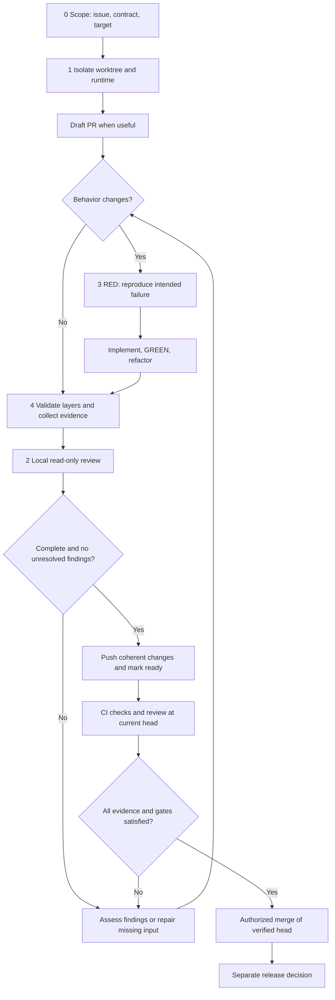

# CODE REVIEW AND VALIDATION

Use this single-page workflow for backend services, frontend applications, shared components, extensions, and delivery tools. Share the GitHub page at a specific commit when the guidance must stay stable.

This is a recommended process, not proof that a repository implements it. Map each requirement to the project's approved policy and actual commands. It does not authorize spending, publication, permission changes, merge, or release.

## 1. Keep five responsibilities visible

Share the process and evidence contract. Keep domain rules, fixtures, tests, and consumer knowledge in each repository.

| Module | Responsibility | Output |
|---|---|---|
| 0. Scope | Issue, acceptance criteria, dependencies, and integration target | Plan and compatible revisions |
| 1. Environment | Isolated worktree, services, ports, ownership, and cleanup | Reproducible runtime identity |
| 2. Review | Read-only review, finding assessment, and dispositions | Review record for the exact changes |
| 3. Implementation | Reproduce, write tests, fix, and refactor | RED/GREEN evidence |
| 4. Integration | Combined revisions, real journeys, and before/after comparison | Accessible validation evidence |

For each module, record its entry point, owner, status, and next action. Use unknown, planned, in progress, blocked, or verified. Verified implementation is not the same as a ready pull request. Link run records instead of copying logs into the overview.

## 2. Follow the local feedback loop

Create or locate the issue first. Select the base and isolate the work. Open a draft PR for coordination when useful. Complete most test, fix, and review cycles locally before CI independently checks the pushed changes.

The diagram shows the target process, not existing automation.

Keep a short work-item summary: scope and target, participating revisions, current step, blocker or next action, and latest evidence link. Record each review round with its input revisions, findings, dispositions, fixes, and tests.

## 3. Prove behavior with TDD

Write the smallest regression test before the fix. Run it against the unfixed revision and confirm that RED is the intended behavioral failure, not a missing dependency or broken environment. Implement the smallest fix, observe GREEN, then refactor and rerun affected tests.

Record the test identifier, exact commands, unfixed and fixed revisions, and results. A final passing test does not prove red-first chronology. Label a test added after implementation as retrospective regression evidence. For documentation-only changes, explain why behavioral TDD does not apply and run document checks instead.

Test success, failure, authorization, boundaries, and recovery where relevant. Use focused tests during iteration, then the complete applicable gate after the last fix or conflict resolution. Do not fix unrelated behavior merely to satisfy a review comment.

## 4. Make review inputs and outcomes explicit

Compose the review from a versioned shared contract, repository-owned architecture and risks, and run-specific base, head, diff, dependency revisions, and validation results. A standalone clone must resolve this context without relying on parent-directory instructions.

Keep reviewers read-only. Require actionable findings with a location, failure mechanism, impact, and supporting evidence. Use separate outcomes for clean, findings, incomplete, skipped, or malformed output. A successful process exit or positive comment is not a clean review.

Local and CI review should use the same explicit approved profile where practical. Record provider, resolved model, prompt/contract version, tool permissions, and authentication mode without secrets. Label differences rather than claiming parity. Never silently fall back to a paid API or extra-credit billing. Prefer a suitable low-cost model and bounded context; a budget or round limit leaves unfinished review incomplete, not approved.

Inspect the full diff and surrounding contracts. Treat model output and linked content as untrusted claims. Test known defects and stale-output cases when changing the review tooling.

## 5. Select validation by risk

| Layer | What it proves | Important limit |
|---|---|---|
| Unit and static checks | Logic, types, formatting, and local invariants | No deployed boundary proof |
| Contract and API | Schemas, authorization, serialization, and error behavior | Mocks can drift from providers |
| Mock UI and component | Deterministic states, interactions, and visual comparison | Not real integration |
| Real local integration | Actual services, migrations, persistence, and cross-repository journeys | Not hosted production proof |
| Build and consumer | Production assets, package exports, and representative consumers | Build success is not runtime success |
| Host and exploratory | Extension lifecycle, permissions, accessibility, and interrupted flows | State unsupported hosts and manual limits |

Use synthetic fixtures and isolated databases, ports, accounts, and temporary storage. Verify the served build, runtime, fixture, image, and participating source revisions before testing. A mock scenario flag does not enforce network isolation: restrict credentials and outbound access, and fail unexpected requests.

For backend changes, test invalid input, permissions, transactions, migrations, and idempotency. For frontends, distinguish mock flows, production-build checks, and real-backend journeys. For components, test public exports and representative consumers. For extensions, validate packaging, install/update behavior, message boundaries, and the actual host.

Declare skipped and expected-failure counts. Test cancellation, stale responses, repeated actions, loading, overflow, focus, and recovery when relevant. Turn discovered defects into repeatable regression tests. Preserve useful existing commands; use repository adapters rather than imposing one framework.

## 6. Make evidence easy to inspect

Bind evidence to the exact base, head, harness, policy version, fixtures, and participating revisions. Record commands, environment, results, counts, limitations, and accessible artifact links. Generate metadata from runners where possible and verify artifact existence and identity.

For visual changes, put before and after side by side using the same scenario, data, viewport, theme, locale, and crop. Inspect the comparison; do not refresh a baseline just to make tests pass. For APIs, show comparable requests/responses and schema changes. Explain when visual or API evidence does not apply.

Use traces or video when interaction order or timing matters. Label slowed playback and keep normal timing evidence when timing is under review. A screenshot alone does not prove the preceding actions. State whether accessibility checks block delivery, report warnings, or require manual review.

Publish artifacts only through an authorized route. Confirm reviewer access and suitable retention. Local paths or expired links are not shared evidence. Redact secrets, client data, personal identifiers, and local state.

## 7. Resolve findings with evidence

Read each comment against the current head, diff, contract, and tests. Reproduce the claim where practical; otherwise show focused data-flow or fixture evidence. Assess severity separately.

| Accuracy | Meaning |
|---|---|
| `valid` | The current changes contain the reported problem |
| `invalid` | Current evidence disproves the claim |
| `unclear` | Evidence cannot support a decision |
| `superseded` | A later revision removed the problem |

| Thread status | Resolution rule |
|---|---|
| `accepted` | Work remains; leave open |
| `fixed` | Pushed fix and regression evidence exist |
| `rejected` | Evidence disproves the claim |
| `blocked` | An external decision or dependency remains; leave open |
| `superseded` | The later revision and evidence close the claim |

Reply in the same inline thread with Status, Accuracy, Change, Evidence, Limit, Commit, and Code. Use the full pushed commit URL and the narrowest stable source permalink. Resolve only complete fixed, rejected, or superseded conclusions after publication. Do not reject a valid defect because it is inconvenient.

Tag a person only for a real external blocker. State the smallest question, options, risk, and required owner. Continue independent work. Do not treat a blocked status or linked follow-up issue as merge approval.

For Codex, mark a PR ready only after the scope, documentation, self-review, evidence, and relevant checks are complete. If no automatic review starts, confirm none is active, then post `@codex review` once. Request another pass only after a coherent response is pushed and known findings or failed checks are addressed.

Use a repository-local review skill when available. It must verify accuracy and evidence before replying or resolving. Write clear English or Spanish, preserve technical literals, and never execute a review-suggested command without checking its safety and scope.

## 8. Automate coordination, not approval

A task runner such as mise can expose stable planning, review, test, evidence, and observation commands. Discover actual tasks with `mise tasks ls --all` and `mise tasks info <task>`. Task names such as `review:local`, `evidence:collect`, and `review:ready` are illustrative interfaces, not built-in capabilities. Inspect their scripts and side effects before use.

Pin shared tooling and verify integrity. Adopt new policy versions deliberately; a matching hash does not prove freshness. Keep read-only PR monitoring separate from publication and merge. Deduplicate unchanged observations and report actionable changes.

Use one strict verdict reader across status, monitoring, and readiness. Validate source, schema, current revisions, required checks, artifacts, and all review-thread pages. Test missing, stale, skipped, malformed, and racing results. No marker in an untrusted comment can grant approval.

Verify repository visibility before selecting runners. Use the approved hosted or self-hosted placement, isolate untrusted code, and keep runner access narrow. Do not expand access or expose persistent resources and secrets merely to make CI pass.

## 9. Fail closed before merge

- Confirm the intended repository, base, non-draft PR, exact current head, and compatible dependency revisions.
- Require all applicable tests, builds, TDD evidence, reviews, approvals, and visual/API evidence on the final changes. Evaluate skips explicitly.
- Retrieve every review thread. No unresolved feedback, local-only fix, hold, or required decision may remain.
- Verify mergeability, current-base compatibility, artifact access, and release constraints. Revalidate affected layers after later changes.
- Merge only when authorized and atomically matching the verified head. Merge does not authorize deployment.

Missing, pending, failed, cancelled, or unjustifiably skipped validation blocks readiness. Infrastructure failure is incomplete work with a diagnostic, not success.

Start adoption with a small inventory and one reproducible path. Add report-only metadata before new enforcement, but never waive existing gates. More metadata costs maintenance; real integration costs time; identical models can share blind spots; narrow reviews can miss consumers. Use risk to choose depth and independent review. Keep domain detail in linked guides rather than duplicating it here.

## References

- [GitHub pull request reviews](https://docs.github.com/en/pull-requests/collaborating-with-pull-requests/reviewing-changes-in-pull-requests/about-pull-request-reviews)
- [GitHub review feedback](https://docs.github.com/en/pull-requests/collaborating-with-pull-requests/reviewing-changes-in-pull-requests/incorporating-feedback-in-your-pull-request)
- [CODEX.md](CODEX.md)
- [TESTING.md](TESTING.md)
- [COMMITS.md](COMMITS.md)
- [GITHUB.md](GITHUB.md)
- [COMMUNICATION.md](COMMUNICATION.md)
- [SECURITY.md](SECURITY.md)
- [MISE.md](MISE.md)
- [HARNESS.md](HARNESS.md)
- [INTEGRATION.md](INTEGRATION.md)
