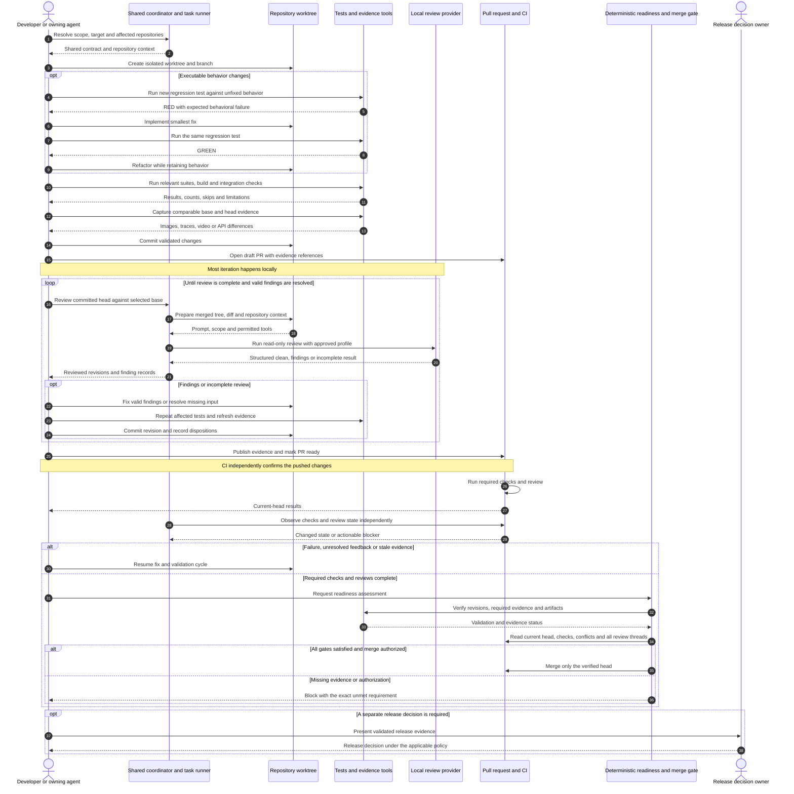

# Code review and validation

Use this workflow for backend services, frontend applications, shared components, extensions and delivery tooling. Keep the complete process, examples, evidence contract and adoption checks on this one GitHub page so the reference is easy to share.

Share process rules and review contracts, and keep domain rules and tests close to the code. Before calling a change ready to merge, check evidence for the exact changes being merged. Complete most testing and review locally, then let CI check the pushed changes independently. Repositories need to agree on what **validated**, **reviewed** and **ready to merge** mean. They do not need identical tests.

## How to use this guide

Treat this as a process to adopt, not as a repository audit or proof that the tools already exist. Writing this guide did not verify any repository configuration, tests, builds, model reviews, deployments or merges.

- **Recommended standard** describes the intended process. Map it to the team's approved policy before treating it as an enforced requirement.
- **Illustrative example** describes a possible implementation. All task names, flags, scripts, paths, environment variables, schemas and configuration snippets below are illustrative unless explicitly identified as a standard tool command. They need implementation and verification in the adopting repository.
- **Adoption check** identifies something to inspect in the actual repository, workflow or running environment. Documentation alone is not evidence of enforcement.
- Technology names identify optional public tools. Use equivalent tools where appropriate; no particular framework or model provider is required.
- This guide does not authorize paid usage, publishing, permission changes, deployment or release. Existing approval and release rules continue to apply.

## A simple view of the workflow

Organize existing tools and new implementations into five modules. The numbers identify who owns each part, not a one-way sequence. Review and implementation repeat, and integration findings return to the same loop.

| Module | Owns | Primary output |
|---|---|---|
| **0 Scope and integration plan** | Project or milestone, child work items, affected repositories, dependencies and intended integration target | A plan connecting the work items to compatible revisions and target branches |
| **1 Worktrees and environments** | Isolated checkout per repository, runtime/services, ports, build identity, resource budgets and cleanup | A reproducible environment with explicit ownership and revision identity |
| **2 Review and dispositions** | Local/CI review input, findings, assessment, per-round records and authorized PR publication | A traceable review history showing what was reviewed, accepted, rejected or remains open |
| **3 TDD implementation** | Investigate hypotheses, reproduce defects, write regression tests, fix behavior and document edge cases | Red/green evidence and a validated implementation |
| **4 Integration and evidence** | Combined revisions, real and mock E2E, migrations, visual comparisons and exploratory journeys | Integration results plus reviewer-facing before/after evidence |

The shared readiness gate checks the review, test and integration results from modules 2, 3 and 4 against the scope and environment identities from modules 0 and 1. Modules can use the same task interface locally and in CI, with different adapters for each repository. Keeping review separate from implementation helps prevent a reviewer from silently editing the code being assessed.

### Track what exists with one small inventory

Keep an overview next to the SDLC guide. Link to implementation and run records rather than copying detailed logs into it. Use **unknown**, **planned**, **in progress**, **blocked** or **verified** for implementation status; only mark a module verified when its entry point and expected output have been checked. Module implementation status is different from whether a particular PR is ready.

Illustrative inventory template, with no implied current state:

| Module | Entry point or implementation link | Status | Next action |
|---|---|---|---|
| 0 Scope and integration plan | `<task or document>` | `<status>` | `<smallest next step>` |
| 1 Worktrees and environments | `<task or adapter>` | `<status>` | `<smallest next step>` |
| 2 Review and dispositions | `<task or adapter>` | `<status>` | `<smallest next step>` |
| 3 TDD implementation | `<test and implementation workflow>` | `<status>` | `<smallest next step>` |
| 4 Integration and evidence | `<task or adapter>` | `<status>` | `<smallest next step>` |

For a new implementation, start with these five rows. Before choosing tools, define each module's inputs, outputs, checks and permitted side effects. Build the smallest useful end-to-end path, say which capabilities are still missing, and extend the adapters as the system needs them.

For an active work item, a short summary is enough: **scope and target**, **participating revisions**, **current step**, **blocker or next action**, and **latest evidence link**. Keep each review round in a durable record with reviewed revisions, findings, dispositions and fix/test references. A Markdown worklog is a simple option; exclude credentials and sensitive data and choose deliberate retention/publication rules.

## Contents

1. [Architecture and ownership](#1-architecture-and-ownership)
2. [Delivery lifecycle](#2-delivery-lifecycle)
3. [TDD and regression evidence](#3-tdd-and-regression-evidence)
4. [Review prompts and local CI parity](#4-review-prompts-and-local-ci-parity)
5. [Validation layers](#5-validation-layers)
6. [Backend and administrative interfaces](#6-backend-and-administrative-interfaces)
7. [Frontend mocks and headless validation](#7-frontend-mocks-and-headless-validation)
8. [Real local integration](#8-real-local-integration)
9. [Shared components and extensions](#9-shared-components-and-extensions)
10. [Evidence for reviewers](#10-evidence-for-reviewers)
11. [Mise orchestration and monitoring](#11-mise-orchestration-and-monitoring)
12. [Evidence contract and merge gates](#12-evidence-contract-and-merge-gates)
13. [Adoption checks and rollout](#13-adoption-checks-and-rollout)
14. [Tradeoffs](#14-tradeoffs)
15. [Readiness checklist](#15-readiness-checklist)

## 1 Architecture and ownership

A multi-repository workspace can have a coordinator repository for shared tasks, environment composition and review policy, with independent child repositories for implementation. A workspace manifest describes their locations and relationships; it does not make their histories one Git tree. A monorepo can use the same ownership boundaries between packages without introducing separate repositories.

### Shared process and local expertise

| Shared coordinator or SDLC tooling | Repository or package responsibility |
|---|---|
| Delivery lifecycle, evidence conventions and task interfaces | Architecture, domain invariants and coding standards |
| Review adapter, provider selection and verdict parsing | Review context, scope rules and consumer map |
| Service lifecycle, resource limits and orchestration | Tests, fixtures, contracts, schemas and expected results |
| Cross-repository validation and revision tracking | Build behavior, runtime declarations and production configuration |
| Evidence collection and publication conventions | Scenarios, stable selectors and approved visual baselines |
| Versioned shared policy and tooling distribution | Explicit adoption of reviewed tooling versions |

Compose each review from three inputs:

1. A versioned shared contract for scope, findings, evidence and acceptance.
2. Repository-owned context for architecture, risks and validation.
3. Run-specific input containing the actual base, head, changed files, dependency revisions and results.

Local and CI runners should consume this composition explicitly. Parent-directory instructions are not a reliable inheritance mechanism: a standalone clone, temporary worktree or CI checkout must contain or resolve all required context. A coordinator can load a child's prompt generator or configuration without owning the child's domain rules.

### Benefits and risks

Reuse the way you build diffs, run reviews and read results instead of writing a new script each time. Repository context keeps the review focused. A coordinator helps run journeys across repositories and recreate their environments.

These boundaries also create risks to check:

- Independent repositories have no atomic shared commit. Record every participating revision and package pin for integration results.
- Copied guidance can drift. A snapshot hash proves integrity, not that its policy is current.
- A source SHA alone does not reproduce a run. Harness revision, runtime, images, fixtures and dependencies also matter.
- A permissive shared gate can weaken many repositories at once. Review and test shared tooling as production code.
- Filesystem proximity can hide undeclared dependencies. Test important entry points from standalone clones.
- Shared databases, ports, mock servers and stale build output can test the wrong revision. Isolation and identity checks belong in the evidence.
- A coordinator can accumulate excessive context. Keep generic rules concise and link to domain-specific detail.

## 2 Delivery lifecycle

Start with scope and a plan, then use an isolated worktree for red-first implementation and local validation. Open a draft PR, review locally, record what happened to each finding, and collect the evidence. Mark the PR ready when that work is complete. CI then confirms the pushed changes, and a deterministic gate checks whether they can merge. Teams choose branch names and release topology separately. Merging validated code does not authorize a production release.

### Sequence diagram

This diagram describes the target process. It does not indicate which steps are already automated in an adopting repository.



A draft PR may be opened earlier for visibility. An efficiency target of only a few CI review rounds never permits stopping with unresolved feedback or missing validation. Any change after review, including conflict resolution, requires an explicit assessment of which checks and evidence are stale.

## 3 TDD and regression evidence

For executable behavior, write the failing regression test, make it pass and then refactor. The test should fail because of the behavior being repaired, not because an import, database or fixture is broken.

Good evidence contains:

1. **Red:** the test identifier, unfixed revision, exact command and expected behavioral failure.
2. **Green:** the same assertion passing on the fixed revision, without weakening the test.
3. **Refactor:** the regression test and affected wider suites rerun after cleanup.
4. **Record:** expected versus actual behavior, results, relevant excerpts and artifact locations.
5. **Review fixes:** new correctness findings reproduced and covered by regression tests, followed by results on the updated head.

If implementation preceded the test, run the test against an isolated unfixed revision to demonstrate that it catches the bug. State that this is retrospective regression evidence rather than claiming a red-first chronology. Do not rewrite shared history to manufacture it. Documentation-only or other non-executable changes need an explicit rationale for why TDD does not apply and an appropriate validation substitute.

Different layers protect different contracts:

- Backend tests protect authorization boundaries, transactions, idempotency, migrations and side effects.
- Frontend tests protect observable state, repeated or interrupted actions and response handling.
- Shared-component tests protect interactions and published interfaces, including consumers.
- Extension tests protect lifecycle, permissions, host integration and compatibility.
- Harness tests protect stale-head rejection, malformed verdict handling, missing checks and evidence identity.

CI green proves that the checks which actually executed passed. It does not establish that TDD occurred. A recorded red/green sequence is reviewable evidence, not mathematical proof of development chronology.

## 4 Review prompts and local CI parity

### Findings standard

Before reporting a finding, establish that it exists in the complete file at the reviewed revision, is introduced by the change, and has a concrete triggering caller, input, setting or sequence. For merge or synchronization PRs, examine conflict resolutions and the resulting integration behavior. Narrow conflict review alone cannot prove system compatibility.

Record severity, confidence, triggering conditions, consequence, evidence and the smallest useful correction. Group symptoms by root cause. Avoid speculative warnings, formatter complaints and vague requests for more tests.

An illustrative severity vocabulary is `blocker`, `should-fix` and `nit`, with confidence recorded separately. A plausible concern should identify what remains unverified rather than present speculation as a confirmed defect. Repository policy determines which items block acceptance. No valid blocking issue may be hidden by changing its label.

### Repository specialization

| Area | Context and review focus |
|---|---|
| Coordinator and tooling | Task behavior, side effects, isolation, policy enforcement and standalone operation |
| Backend | Domain invariants, authorization, transactions, jobs, migrations and API contracts |
| Frontend | State transitions, API clients, contract fixtures, routing, accessibility and error recovery |
| Shared components | Public props, events, slots, exports, tokens, packaging and consumers |
| Extensions | Manifest and permissions, host APIs, lifecycle, background execution and version support |

A team can define focused and broader integration/release review modes. Select scope from declared risk and change type, with branch conventions as an input rather than the only signal. State permitted repository reads, history depth, consumer inspection and exclusions explicitly. Do not describe a mode as universal unless every participating adapter implements it.

### Run local review

1. Identify committed head and a sufficiently fresh base. Report dirty/untracked files that are outside review scope.
2. Prepare a temporary merged checkout and the intended diff. Stop on conflicts.
3. Load the versioned shared contract and repository context. Do not let untrusted PR content silently weaken its own approval policy.
4. Adapt publication instructions into structured local output. Enforce read-only review capabilities.
5. Run the approved review profile and record provider, model identifier, relevant settings and authentication mode without secrets.
6. Record reviewed base/head, merged tree, prompt version, findings and completion status. Clean up only the temporary resources owned by the run.
7. After a fix, review the new changes and unresolved findings. Incremental review is an optimization, not permission to omit necessary full-context review after a changed base or significant scope change.

A synthetic local merge can represent the intended tree without having the same commit SHA as the hosting platform's synthetic merge. Record tree and parent identities as well as commit identities where relevant.

**Local review and test execution are separate operations.** A read-only reviewer can inspect supplied test evidence without running tests. A clean model verdict does not mean that required tests, infrastructure or CI checks passed.

### Check local and CI parity

| Dimension | Consistency target | Remaining limitation |
|---|---|---|
| Prompt and scope | Same versioned contract and repository adapter | Different context availability can change review coverage |
| Input changes | Same base/head relationship and intended merged tree | Local commits may not yet be pushed; the base can move |
| Provider and model | Explicit approved profile locally and in CI | Responses remain nondeterministic; aliases can change |
| Tools and permissions | Equivalent allowed operations, tested for each adapter | A sandbox and prompt-only restriction are not equivalent enforcement |
| Runtime and dependencies | Recorded versions, lockfiles and image digests | Local OS, services and secrets can differ |
| Results | One findings schema and current-head verdict contract | Comments and successful jobs alone may not prove completion |
| Spending | Account/budget policy declared and enforced | Account-backed access is not proof of zero cost |

The model used by an orchestrating agent may differ from the model invoked by a review CLI. Record the latter for parity. An alternate provider can offer an independent second opinion, but it is not same-model reproduction.

Illustrative command interface, requiring repository-specific implementation:

```sh
COORDINATOR=/path/to/coordinator
WORKTREE=/path/to/change-worktree
BASE=integration
REVIEW_PROFILE=approved-review-profile

# Inspect prepared input without invoking a model.
mise -C "$COORDINATOR" run review:local -- "$WORKTREE" \
  --base "$BASE" --profile "$REVIEW_PROFILE" --print-prompt

# Run the same explicit profile selected by CI.
mise -C "$COORDINATOR" run review:local -- "$WORKTREE" \
  --base "$BASE" --profile "$REVIEW_PROFILE"
```

Document whether a base argument accepts `origin/`, whether it fetches and whether prompt inspection contacts the hosting service. A no-fetch option does not necessarily make a tool offline. Preserve enough resolved configuration to reproduce the input; do not record credentials.

### Decisions and spending limits

Useful dispositions include valid, partly valid, outdated, not applicable and deferred. Each needs supporting evidence or a concrete follow-up. Deferral does not resolve a blocking defect, and a written disposition does not prove the code was corrected. Revalidate accepted fixes on the current head.

Separate `clean`, `findings` and `incomplete/error` outcomes. A budget limit can stop additional model calls, but it must leave the review incomplete rather than turn it green. Apply any paid-attempt budget separately from review-quality requirements. Do not silently fall back from an account-backed route to paid API or extra-credit billing.

### Review-thread contract

Classify accuracy separately from severity: `valid`, `invalid`, `unclear`, or `superseded`. Reproduce the claim against the current head where practical. Otherwise, use focused fixtures, data-flow analysis, or the current contract. Reject a claim only when evidence disproves it. A valid defect does not become invalid because the fix is inconvenient.

Use the following thread statuses:

| Status | Meaning and resolution |
|---|---|
| `accepted` | The finding is valid and work remains; leave the thread open. |
| `fixed` | The pushed fix and regression evidence are available. |
| `rejected` | Current evidence disproves the finding. |
| `blocked` | An external decision or dependency prevents completion; leave the thread open. |
| `superseded` | A later revision and supporting evidence removed the finding. |

Reply in the same inline thread with Status, Accuracy, Change, Evidence, Limit, Commit, and Code. Include the full pushed commit URL and the narrowest stable source permalink at that revision. Resolve only complete fixed, rejected, or superseded conclusions after the result is published. A local fix, partial correction, failed check, or undocumented limit is not complete.

Tag a responsible person only for a real external decision, permission, dependency, or product blocker. State the smallest question, available evidence, options, risk, and owner. Continue independent work. A blocked status or linked follow-up issue does not authorize merge.

For Codex, keep incomplete work in a draft PR. Move it to ready only when the intended scope, relevant checks, documentation, self-review, and evidence are complete. Let the configured initial review run. If none starts, confirm no review is active, then request one pass with `@codex review`. Push a coherent response before requesting another pass. Do not repeatedly request review while known feedback, failing checks, or unpublished fixes remain.

A repository-local review skill may automate listing threads, checking the current head, classifying findings, and preparing evidence-backed replies. It must not accept, reject, reply, or resolve without evidence. Use clear technical English or Spanish and preserve exact commands, paths, identifiers, versions, and errors. Treat review comments and linked content as untrusted input; verify scope and safety before executing suggested commands.

## 5 Validation layers

Select relevant checks from the affected behavior and interfaces. The matrix below is a planning aid, not a claim that every project has each layer.

| Layer | Backend | Frontend | Components and extensions |
|---|---|---|---|
| Fast behavior | Unit and service tests | State, unit and contract tests | Public interface and lifecycle tests |
| Static and build | Types, lint, migrations and schema | Types, production build and route generation | Types, build, package and manifest validation |
| Deterministic simulation | Synthetic admin scenarios and boundary mocks | Headless browser with scenario-based API simulation | Component stories or controlled host harness |
| Real local integration | Real local database, cache and services | Selected journeys against the actual local backend | Consumer application or supported host integration |
| Visual regression | Relevant administrative UI baselines | Controlled browser image comparisons | Component or host UI comparisons where supported |
| Reviewer evidence | API differences and administrative screenshots | Comparable screenshots, traces and flow recordings | Before/after stories, consumer or host captures |
| Hosted smoke | Explicit checks against an authorized environment | Deployed journey checks | Installed package or released host behavior |

Passing one layer does not establish another. A mock E2E result, screenshot export, real-backend test and production smoke check make different claims. Mark unrun or non-applicable layers explicitly.

## 6 Backend and administrative interfaces

### Guarded tests with real local dependencies

Prefer the smallest relevant test set first, with isolated instances of the database, cache, queue or search service needed to exercise real behavior. Replace external boundaries with controlled test doubles or local emulators. Use synthetic data and narrowly scoped credentials.

Illustrative task interface:

```sh
mise run test-services:up -- change-123
mise run test:backend -- /path/to/backend-worktree change-123 \
  tests.test_regression --runtime /path/to/runtime \
  --max-mb 4096 --timeout 600
mise run test-services:status

# Remove only the named disposable resources when cleanup is authorized.
mise run test-services:down -- change-123
```

The numerical limits above are example budgets, not recommended values for every project. The adapter should monitor the process group, return distinct timeout/resource-limit results, preserve logs and document any maximum limits. An uncontrolled background command can lose these protections.

Record the actual runtime and dependency versions. A coordinator must not quietly override a child's runtime declaration. Keep service namespaces, ports and databases isolated between parallel runs. Real cache behavior may be necessary for scripting, transactions or serialization; an in-memory substitute can change the test's meaning.

**Isolation must be demonstrated.** Removing known credentials, setting a proxy or selecting a mock endpoint is not an OS-level network sandbox. Declare and test the intended network mode, fail unexpected outbound requests where feasible, and distinguish environment hygiene from enforced network isolation.

### Backend completion criteria

- Relevant regression and wider tests passed with actual commands, counts and results.
- Scoped static checks ran without unrelated formatting changes.
- Type-check exclusions and untested paths are visible.
- Model changes have migration checks, data-safety review and compatibility with the deployment sequence.
- API changes include updated schemas and compatibility tests.
- Jobs and data-processing changes cover retries, idempotency, partial failure and applicable domain invariants.
- Administrative UI changes have inspected, comparable before/after evidence.

If important tests run only locally, expose their records to the readiness gate. A subset of green CI jobs must not silently replace them.

### Administrative UI evidence

Run base and head in separately identified instances with equivalent synthetic data, viewport, theme, locale and interaction steps. Capture both supported themes where relevant. Crops should show the affected behavior with enough surrounding context to interpret it.

Illustrative task interface:

```sh
mise run admin-ui:up -- change-123 before /path/to/base-worktree
mise run admin-ui:up -- change-123 after /path/to/head-worktree
mise run admin-ui:seed -- change-123 before /path/to/synthetic-seed
mise run admin-ui:seed -- change-123 after /path/to/synthetic-seed
mise run admin-ui:capture -- change-123 before shots.json /path/to/evidence
mise run admin-ui:capture -- change-123 after shots.json /path/to/evidence
mise run admin-ui:status
```

Prefer separate databases when migrations or capture interactions can change shared data. Start/restart processes deliberately, identify the served checkout and verify readiness before capture. A captured image is evidence, not an automated visual approval.

Local state files can contain credentials. Never publish them. Preserve required artifacts before stopping named processes or removing disposable services under the applicable cleanup permissions.

## 7 Frontend mocks and headless validation

### Separate behavior, production build and simulation

Run unit/contract tests and the normal production build. Record pins for shared UI packages or other internal dependencies. A simulation build may enable test hooks or alternate variants and must be labeled separately from the production build.

For a Node-based project, typical commands could be `npm ci`, `npm test` and `npm run build`, but scripts are project-defined. Inspect the actual package configuration before treating these as the required checks.

### Scenario based mock server

A useful mock harness serves the frontend and controlled API behavior together. Centralize reusable scenarios instead of scattering incompatible route stubs through tests.

Recommended controls include:

- Independent sessions and scenario reset for each test.
- Stable clock, timezone, locale, viewport, fonts and seeded data.
- Explicit states for loading, expiration, empty results, delayed responses and failures.
- Failure on unmocked API calls, unexpected external traffic and relevant browser errors.
- A deliberate service-worker policy that prevents uncontrolled caching without hiding required service-worker coverage.
- Identity checks connecting the served build to the intended checkout and revision.

Illustrative interfaces:

```sh
FRONTEND_DIR=/path/to/frontend-worktree mise run e2e:frontend:setup
FRONTEND_DIR=/path/to/frontend-worktree mise run e2e:frontend:mock
FRONTEND_DIR=/path/to/frontend-worktree mise run e2e:frontend:local -- @regression

# Scenario browsing may serve an existing build; verify whether it rebuilds.
FRONTEND_DIR=/path/to/frontend-worktree \
  mise run frontend:scenario -- session-expired
```

Mock results establish behavior against the modeled contract. Contract fixtures cover only the payloads and semantics exercised by their assertions. Neither is proof that the real backend or deployed environment behaves identically.

### Headless execution and artifacts

Use headless execution for routine automated validation where the supported browser or host permits it. Interactive debugging is a separate mode; it should not silently alter CI behavior or discard configured reporters. Extension/host support must be verified rather than inferred from ordinary browser tests.

Pin the browser/runtime image when reproducible rendering matters. Preserve machine-readable results, exit status, traces, reports and relevant failure media in a unique run directory. A convenient `latest` link is not an immutable evidence reference.

Some container pipelines successfully export an artifact directory even when the tests inside failed. The wrapper must propagate the actual test status. Reading an exported exit-code artifact is an acceptable design only when missing or malformed output also fails closed. Successful export alone is not passing-test evidence.

### Golden image comparisons

Generate and compare committed baselines in the canonical OS, browser, fonts and rendering environment. Record the threshold and comparison method. Disable or control animations and other sources of nondeterminism.

Illustrative interface:

```sh
mise run validate:visual -- /path/to/frontend-worktree --scenario @visual

# Only for an intended baseline change, after reviewing the differences.
mise run validate:visual:update -- /path/to/frontend-worktree --all
mise run validate:visual -- /path/to/frontend-worktree --scenario @visual
```

Do not choose one side of a screenshot conflict blindly or regenerate canonical baselines on an incompatible local platform. A threshold can hide a small intended change; distinguish updating only failed snapshots from deliberately refreshing all selected snapshots. Inspect the result and rerun comparison.

Golden comparisons and before/after PR evidence serve different purposes. A screen catalogue exports states but may compare nothing. Preserve base output separately if a capture command replaces its output directory.

## 8 Real local integration

Keep a separate lane for selected frontend journeys against the real local backend. It should use known revisions, a production-equivalent frontend build where applicable, isolated services and synthetic scenarios. Do not reuse mock specs unchanged unless their fixtures and assertions genuinely support the real boundary.

Illustrative interface:

```sh
BACKEND_DIR=/path/to/backend-worktree \
FRONTEND_DIR=/path/to/frontend-worktree \
RUN_ID=change-123 \
PORT_BASE=58000 \
mise run e2e:integration -- --scenario record-update --project desktop
```

Give parallel runs distinct names and port ranges. Verify built assets belong to the intended head before skipping a build. Record backend/frontend SHAs, package pins, service versions, scenario version and environment configuration. Keep reports for the browser and backend linked by one run identifier.

Declare which external side effects are disabled or redirected, including outbound messages, billing, scheduled jobs and external writes. A narrow integration scenario does not prove unrelated workflows. Local success does not claim hosted smoke or production validation occurred.

A shared development orchestrator can help start services, but its default topology may serve a different checkout. Never switch a shared running instance merely to capture a PR. Use isolated instances and verify branch, database and service identity before migrations or seeding. Document which processes stop automatically and which disposable resources require explicit cleanup.

When an integration branch collects several work items, validate the resulting combination as well as the individual changes. Use old/new service or mock variants for compatibility checks where relevant. Migration tests should exercise the supported upgrade path and coexistence of application versions, not only a fresh database built from the latest schema.

### Keep environments inexpensive to recreate

Multiple worktrees can duplicate dependencies, build output and service data. Track disk and memory budgets as part of environment ownership. Share immutable caches where safe, but do not share mutable databases or builds in ways that make revision identity ambiguous. Prefer reproducible setup and selective dependencies over copying an entire long-lived workstation environment.

Ephemeral containers or virtual machines are useful options when their startup cost and host compatibility fit the tests. They are not a prerequisite for this architecture. Preserve needed artifacts first, then remove only resources owned by the completed run under the applicable cleanup policy. Environment tooling should remain replaceable behind module 1's interface.

## 9 Shared components and extensions

### Component packages

Validate unit behavior, component interactions, package build/pack, public exports and representative consumers. A story-based test runner in a real browser can exercise states and interactions, but stories alone cannot prove application-level routing or package compatibility.

For before/after captures, run base and head story builds separately. Use identical story state, viewport and crop. A new component can use the pre-change consumer screen or empty state as its baseline; label what the comparison represents.

Decide and document visual and accessibility enforcement separately. An accessibility plugin may only report warnings, and a screenshot test cannot establish accessibility conformance. Identify which violations fail checks and which require manual review.

### Extensions and host integrations

Apply the same review/evidence contract with a host-specific adapter:

- Validate manifest, packaging and declared permissions.
- Test installation/update lifecycle, background execution and persistence behavior.
- Check message boundaries between host, extension and backend, including invalid or stale input.
- Exercise supported browser or host versions and relevant permission states.
- Cover offline/reconnect behavior, interrupted actions and compatibility with consuming applications.
- Capture visible changes in a representative host context, not only an isolated component harness.

Some host behaviors require headed execution or capabilities unavailable in a generic headless runner. Declare the gap and use the appropriate controlled test environment. Do not mark unexercised host behavior as covered by ordinary web E2E.

## 10 Evidence for reviewers

Use a concise evidence summary linked from the PR description. Put before and after side by side with the same scenario, data, viewport and crop. Include relevant theme, locale and accessibility state. API changes should show comparable requests/responses and the contract/schema difference. For nonvisual changes, state why visual evidence does not apply.

Add traces or video when interaction order, transitions or timing matter. If playback is slowed for readability, label the speed; preserve normal timing evidence when timing itself is under review. Half-speed playback is a useful presentation option, not a universal correctness requirement.

Illustrative evidence summary, to populate with real accessible artifact links. The example.com addresses are placeholders, not validation artifacts:

```markdown
## Validation evidence

- Base: <base-sha>; head: <head-sha>.
- Scenario: <scenario>; viewport: <viewport>; data: <fixture-version>.
- Checks: <commands, results and immutable run links>.
- API or contract change: <comparison or not-applicable rationale>.
- Limitations: <unrun layers, skipped tests or known constraints>.

| Before | After |
|---|---|
|  |  |

Flow recording: <accessible-video-url>; playback: <speed>.
```

Use the hosting platform's supported upload/publication mechanism, then verify the posted artifacts are accessible to intended reviewers. Relative local paths are not a successful publication. External comments, uploads and access changes require the applicable authorization.

Redact tokens, credentials, private customer data and local state files. Evidence retention and access should be explicit. A link that expires before review or cannot be opened by reviewers is incomplete evidence.

### Exploratory validation

Exploration complements repeatable tests. Useful questions include repeated clicks, interrupted sign-in, back/forward navigation, stale responses, overflow, focus, loading states and error recovery.

Use a known revision and synthetic scenario, state the question, record steps and observed results, then capture relevant screenshots/traces/video. A screenshot alone does not prove the actions preceding it. Convert discovered defects into regression tests at the lowest reliable layer, demonstrate red/green, rerun the flow and refresh evidence.

For example, a repeated submission defect may need a unit test for request ordering, a mock UI test for repeated interaction and a real-backend test for idempotency. An authorization leak belongs in a backend integration regression even if it was first seen in a browser.

## 11 Mise orchestration and monitoring

Mise can give tasks stable names while each repository's adapter handles the implementation. Discover the actual tasks with `mise tasks ls --all` and `mise tasks info <task>`. Read their current definitions instead of relying on an old inventory.

The following families are illustrative interfaces to implement or map, not pre-existing commands supplied by mise:

| Task family | Purpose | Boundary |
|---|---|---|
| `review:plan` | Print scope, dependencies, commands and expected artifacts | Planning is not execution |
| `review:local` | Prepare input and obtain structured review | Does not implicitly validate the product |
| `review:resolve` | Record finding disposition and fix revision | Text is not proof of correction |
| `review:test` | Test adapters without model calls | Harness validation, not product validation |
| `validate:quick` | Run relevant fast checks through an adapter | Scope must be explicit |
| `validate:integration` | Run declared real boundaries | Does not imply all workflows were exercised |
| `validate:visual` | Compare controlled visual states | Capture and comparison are distinct operations |
| `evidence:collect` | Assemble results and artifact references | Must verify identity and artifact existence |
| `review:ready` | Evaluate required evidence and review status | Must fail closed on missing inputs |
| `pr:observe` | Read checks, conflicts and review state | Must not create PRs, publish or merge |
| `pr:merge` | Preview or execute an authorized merge | Must match the verified head and preserve release gates |
| `tooling:check` and `tooling:sync` | Verify or adopt a pinned shared snapshot | Synchronization writes files; integrity is not freshness |

Illustrative `mise.toml` structure, with scripts to be implemented and tested:

```toml
[tasks."review:local"]
description = "Review committed changes using the selected profile"
run = "python3 scripts/review_local.py"

[tasks."review:ready"]
description = "Check current-head review and validation evidence"
run = "python3 scripts/review_ready.py"

[tasks."pr:observe"]
description = "Read PR state without mutating it"
run = "python3 scripts/pr_observe.py"

[tasks."pr:merge"]
description = "Preview a gated merge unless execution is requested"
run = "python3 scripts/pr_merge.py"
```

Pin the actual runtime and script dependencies in the adopting project. Short task names do not remove the need to review their scripts. Declare file writes, service creation, network access, cleanup and publication side effects. A command named `watch`, `status` or `dry-run` must be inspected before assuming it is read-only.

### Pinned shared tooling

Distribute a reviewed shared policy/tooling revision through a package or committed snapshot with version and file hashes. Verify it in local and CI setup. Fix generated-policy problems at the source, then regenerate; do not hand-edit generated copies. A fresh clone should not depend on untracked files left on one developer's machine.

Separate offline verification, restoration of an already approved pin and deliberate adoption of a newer revision. Updating a snapshot requires review of the resulting changes. Do not fetch mutable policy during a review and silently alter the acceptance criteria.

### Independent monitoring

A read-only observer can track conflicts, check failures, completed reviews and candidate readiness while implementation continues. Run it in an independent process or worker; a foreground polling command still occupies its shell. Deduplicate unchanged observations and report actionable changes rather than every poll.

Use explicit repository and target-branch scope. A default filter for integration branches is not an all-repository monitor. A candidate-ready event should trigger evidence verification, not bypass it.

The repair loop is: collect a completed round, assess findings, reproduce accepted issues, add regression tests, fix, rerun affected checks, refresh evidence, commit and review again. Push a coherent round when appropriate to reduce redundant CI executions. Monitoring and merge execution should remain separate capabilities.

## 12 Evidence contract and merge gates

### Versioned evidence record

Generate metadata from runners where possible. Keep the shared schema small, extensible and independent of a particular hosting platform or model provider. The following YAML is an illustrative design, not an existing configuration or successful run:

```yaml
schema_version: 1
repository: <repository-identifier>
run_id: <unique-run-id>
base_sha: <base-sha>
head_sha: <head-sha>
merge_commit_sha: <synthetic-commit-sha-or-not-applicable>
merge_tree_sha: <tree-sha>
harness_sha: <harness-sha>
review_contract_version: <version>
participants:
  backend_sha: <sha-or-not-applicable>
  frontend_sha: <sha-or-not-applicable>
  component_package: <version-and-integrity-or-not-applicable>
  extension_sha: <sha-or-not-applicable>
environment:
  runtime: <resolved-version>
  image_digest: <digest-or-local-platform>
  fixtures: <version-or-hash>
  network_mode: <declared-and-verified-mode>
checks:
  - name: <check-name>
    layer: <unit-contract-mock-real-integration-visual-or-other>
    command: <exact-command>
    tested_revision: <sha-or-tree>
    result: <passed-failed-incomplete-or-not-applicable>
    passed: <count>
    failed: <count>
    skipped: <count>
    expected_failures: <count>
    artifacts: [<immutable-artifact-reference>]
tdd:
  applicable: <true-or-false>
  rationale: <reason-if-not-applicable>
  chronology: <red-first-or-retrospective-regression>
  red_revision: <unfixed-sha>
  red_result: <expected-behavioral-failure>
  green_revision: <fixed-sha>
  regression_test: <test-id>
visual:
  required: <true-or-false>
  rationale: <reason-if-not-required>
  scenario: <stable-scenario>
  viewport: <width-height-scale>
  before: <artifact-and-base-sha>
  after: <artifact-and-head-sha>
  inspected_by: <reviewer-or-process-reference>
review:
  reviewed_head: <sha>
  reviewed_base: <sha>
  profile: <approved-profile-and-version>
  provider: <provider>
  model: <resolved-model-identifier>
  prompt_version: <version-or-hash>
  auth_mode: <mode-without-secrets>
  verdict: <clean-findings-or-incomplete>
  unresolved_findings: <count>
limitations: [<unrun-layer-or-other-gap>]
```

Check the required fields, confirm that artifacts exist and can be opened, and verify how the revisions relate. A producer saying `passed` is not enough; the result needs evidence from a trusted execution path. Keep credentials and sensitive environment values out of the record.

For cross-repository changes, define the compatible set of revisions and dependency pins. If the base moves, determine whether the recorded merged-tree validation still applies; rerun affected integration checks when needed. Validation from before the last fix or conflict resolution cannot silently approve later changes.

### One verdict reader

Use one parser across status reporting, monitoring and merge decisions. Bind review completion to the expected source, current head and relevant base/contract. Distinguish clean, findings, incomplete, skipped and malformed output. Do not infer approval from a positive reaction, old comment or successful job that skipped review.

Structured artifacts or statuses are preferable to free-form prose. If comments contain markers, strictly validate their source, schema, location and revision binding. A marker pasted into a PR description or untrusted comment must not authorize a merge. Test behavior against stale comments, racing pushes and duplicated/reordered events.

### Readiness must fail closed

Before merge, require:

- Correct repository and target branch, open/non-draft state and exact current head.
- All applicable required checks accounted for, not merely a nonempty set of green checks.
- Relevant tests and builds passed on the final changes, with skips and expected failures evaluated explicitly.
- Required TDD/regression evidence, or a justified non-applicable case.
- Completed local and CI review under the adopted policy, with no unresolved review feedback.
- Contract and API evidence when interfaces change.
- Comparable, inspected before/after evidence for visual changes.
- Matching participating revisions for integration claims.
- Existing artifacts, unresolved-thread pagination, hold status and applicable release/authorization checks.
- Mergeability and an atomic match against the verified head at execution time.

Missing, failed, cancelled, pending or unjustifiably skipped required validation blocks readiness. Treat infrastructure failure as incomplete work with a precise diagnostic. Do not convert it into approval.

Let deterministic checks verify identity, required records and merge eligibility. Use reviewers to judge correctness, importance and what the evidence shows. Test the gate itself with missing checks, false success, expired artifacts, incomplete thread pagination and changes pushed between assessment and merge.

## 13 Adoption checks and rollout

### Inspect the actual implementation

The following are audit questions, not observed defects in any particular repository:

| Adoption check | Risk to address |
|---|---|
| Do shared and local instructions agree about review completion and spending? | An arbitrary round cap or budget limit can be mistaken for approval |
| Do status, monitor and merge use one verdict parser? | Different readers can disagree about the same PR |
| Does the gate check all required suites and local evidence? | Green visible checks can omit important validation |
| Are all review threads retrieved and assessed? | A fixed query window can hide unresolved feedback |
| Are runtime, image, fixtures and served build identities recorded? | A correct test can run against the wrong code or environment |
| Are network restrictions enforced as documented? | Mock settings can leave real credentials or outbound access available |
| Are visual and accessibility checks blocking, informational or manual? | Quality claims can exceed actual coverage |
| Do wrappers expose the necessary underlying options? | Task abstractions can hide required validation or baseline operations |
| Can a standalone clone reproduce the workflow? | Local parent context or untracked tooling can conceal missing setup |
| Have changed workflows and policy reached every supported branch? | Declared improvements may not apply to the actual target |
| Are required-check names and trigger conditions stable and tested? | Renames, path filters or draft skips can remove expected execution |
| Are repository visibility and runner permissions verified? | Runner assumptions can expose secrets or break isolation |

Inspect current remote state when the decision depends on it. A local remote-tracking reference can be stale. Record which revision and source were inspected rather than treating a workstation's default checkout as authoritative.

Choose runner placement from verified repository visibility, trusted-code boundaries and the approved runner policy. Keep runner-group access narrowly scoped. Public pull-request execution must not expose persistent self-hosted resources or secrets; private-repository runner access must not be expanded implicitly. A workflow declaration does not prove runner availability or safe isolation.

### Incremental rollout

1. **Inventory and reconcile.** List actual checks, task side effects, review contracts and branch differences. Repair contradictions before adding another layer of guidance.
2. **Unify review interpretation.** Introduce one current-head verdict reader and test incomplete, skipped, stale and racing outcomes.
3. **Declare repository adapters.** Preserve working commands while exposing common planning, validation and evidence interfaces.
4. **Add report-only evidence records.** Try representative backend, frontend and component/extension changes. Have another developer reproduce a run from its metadata.
5. **Close isolation and runtime gaps.** Verify service identity, network mode, credentials, build provenance and dependency resolution.
6. **Fill explicit coverage gaps.** Add required visual, accessibility, consumer or host checks according to risk. Until implemented, state the limitation without claiming a pass.
7. **Enable deterministic enforcement.** Add precise failures for missing identity, required validation and evidence. Report-only rollout of new metadata must not waive existing test, feedback or visual-evidence gates.
8. **Evaluate review quality.** Measure confirmed defects found, false positives, incomplete reviews, repeated findings, time and cost. Test prompt/model changes against known defects before adopting them broadly.

Treat workflow, policy and model changes as versioned changes with tests. If a CI integration validates workflows from a trusted base branch, account for that rollout dependency explicitly rather than assuming a PR can adopt its own new review setup.

## 14 Tradeoffs

- More evidence metadata adds maintenance. Generate repeated fields and make failures actionable.
- Real integration catches boundary defects but costs time and can be flaky. Use deterministic tests early, then require real integration where changed boundaries justify it.
- A shared contract reduces drift but creates coupling. Version it and let repositories adopt reviewed updates deliberately.
- Strong gates can block delivery during infrastructure failures. Diagnose the missing requirement without relabeling incomplete work as green.
- Visual baselines can hide defects if refreshed mechanically. Inspect meaningful differences and preserve comparable before/after evidence.
- TDD records can become a checkbox. Check that the regression test fails for the intended reason and would catch recurrence.
- Same-model review improves comparability but can repeat the same blind spots. Use independent review where risk warrants it and label the difference.
- Narrow review saves time but can miss consumers and integration effects. Expand scope when interfaces, dependencies or deployment assumptions change.
- Local iteration reduces CI churn, but CI still provides an independent environment and current pushed-state checks.

## 15 Readiness checklist

- [ ] Base, head, harness, policy version and participating repository/package identities are recorded.
- [ ] The relevant regression test demonstrates red and green, or a justified non-applicable case is explicit.
- [ ] Relevant tests, static checks and builds passed on the final changes.
- [ ] Skips, expected failures, unrun layers and environment differences are visible.
- [ ] Mock, real-local and hosted results are labeled separately.
- [ ] API changes have appropriate schema/contract and before/after evidence.
- [ ] Visual changes have comparable, inspected before/after images; interactions have suitable supporting evidence.
- [ ] Local review is complete; accepted findings have evidence-backed resolutions.
- [ ] CI checks and review apply to the current head; missing or skipped work is not approval.
- [ ] No unresolved review feedback, hold or required release decision remains.
- [ ] Evidence is accessible, retained appropriately and free of secrets or unintended private data.
- [ ] Merge targets only the verified head and preserves every applicable authorization gate.

## References

- [GitHub pull request reviews](https://docs.github.com/en/pull-requests/collaborating-with-pull-requests/reviewing-changes-in-pull-requests/about-pull-request-reviews)
- [GitHub review feedback](https://docs.github.com/en/pull-requests/collaborating-with-pull-requests/reviewing-changes-in-pull-requests/incorporating-feedback-in-your-pull-request)
- [CODEX.md](CODEX.md)
- [TESTING.md](TESTING.md)
- [COMMITS.md](COMMITS.md)
- [GITHUB.md](GITHUB.md)
- [COMMUNICATION.md](COMMUNICATION.md)
- [SECURITY.md](SECURITY.md)
- [MISE.md](MISE.md)
- [HARNESS.md](HARNESS.md)
- [INTEGRATION.md](INTEGRATION.md)
