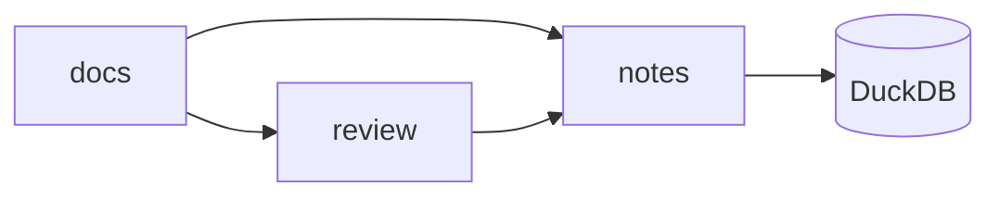

# ASPIRE

Guía complementaria extraída del documento SDLC.

Este archivo es la referencia para desarrollo opcional con Aspire, tests, entornos
preview, deploy, red, ciclo de vida, secretos, integraciones de IA y observabilidad.

## Desarrollo local de Aspire y observabilidad de runtime

Aspire es opcional.

Úselo si el proyecto tiene varios servicios, dependencias, contenedores o
procesos que necesitan un ciclo local de desarrollo.

Aspire no es un framework obligatorio. El proyecto puede usar otra herramienta
local de orquestación con las mismas responsabilidades.

### Objetivos

La capa local de orquestación debe proporcionar:

- un comando para iniciar el sistema local;
- orden de dependencias;
- salud de recursos;
- descubrimiento de endpoints;
- logs de consola;
- logs estructurados;
- trazas distribuidas;
- reinicio de recursos;
- apagado acotado;
- integración con tests locales;
- diagnósticos que un agente pueda leer.

El software funcional debe seguir como el objetivo principal.

La capa de orquestación no debe ocultar fallos de la aplicación.

### Configuración

Si el proyecto usa Aspire, instale la versión de Aspire CLI aprobada por el
proyecto. Confirme que la versión instalada admite cada comando de esta guía.

Para un proyecto Aspire existente, use este comando solo si la versión instalada
de Aspire lo admite:

```sh
aspire agent init
```

Para una configuración no interactiva, use este comando solo si la versión
instalada admite estas opciones:

```sh
aspire agent init \
  --non-interactive \
  --skills all \
  --skill-locations standard
```

Use la ubicación de agentes admitida por el proyecto.

No instale skills de forma global salvo que el equipo exija disponibilidad global.

El paquete oficial de flujos de Aspire incluye:

- `aspire`;
- `aspire-init`;
- `aspire-orchestration`;
- `aspire-monitoring`;
- `aspire-deployment`;
- `aspireify`.

Use la skill de nivel superior `aspire` si no está claro cuál flujo es correcto.

Use `aspire-orchestration` para operaciones de ciclo de vida.

Use `aspire-monitoring` para logs, trazas, métricas y diagnóstico de runtime.

Use `aspireify` al agregar Aspire a una base de código existente.

Consulte la [documentación oficial de skills de Aspire](https://aspire.dev/get-started/aspire-skills/).

### Configuración de Aspire MCP

Use skills de Aspire para enseñar el flujo a los agentes.

Use Aspire MCP si los agentes necesitan información en vivo de una aplicación en
ejecución.

Inicie el servidor MCP con este comando solo si la versión instalada lo admite:

```sh
aspire agent mcp
```

Para Claude Code u otros clientes MCP, el proyecto puede usar esta configuración:

```json
{
  "mcpServers": {
    "aspire": {
      "command": "aspire",
      "args": [
        "agent",
        "mcp"
      ]
    }
  }
}
```

Para VS Code, use la configuración `servers` específica del cliente.

El proyecto debe generar o validar la configuración con este comando solo si la
versión instalada lo admite:

```sh
aspire agent init
```

El servidor Aspire MCP usa comunicación STDIO local.

No abre un listener de red.

Es una herramienta para tiempo de desarrollo.

No lo exponga mediante un endpoint público.

Consulte la [documentación oficial de Aspire MCP](https://aspire.dev/get-started/aspire-mcp-server/).

### Ciclo de observabilidad del agente

Cuando un agente trabaje en un sistema local en ejecución, use este orden:

1. Liste los AppHost.
2. Seleccione el AppHost correcto.
3. Liste los recursos.
4. Compruebe el estado y la salud de los recursos.
5. Descubra el endpoint objetivo.
6. Reproduzca el comportamiento.
7. Lea los logs de consola.
8. Lea los logs estructurados.
9. Encuentre la traza distribuida relacionada.
10. Lea los logs estructurados de esa traza.
11. Forme un diagnóstico.
12. Cambie el límite relevante más pequeño.
13. Reproduzca el comportamiento de nuevo.
14. Confirme la corrección con tests.
15. Registre la evidencia.

No empiece por cambiar código.

Primero inspeccione el sistema en ejecución.

### Herramientas de Aspire MCP

El agente debe usar las siguientes herramientas si están disponibles:

- `list_apphosts`;
- `select_apphost`;
- `list_resources`;
- `list_console_logs`;
- `list_structured_logs`;
- `list_traces`;
- `list_trace_structured_logs`;
- `execute_resource_command`;
- `doctor`;
- `list_integrations`;
- `get_integration_docs`;
- `search_docs`;
- `get_doc`.

Use consultas acotadas.

Solicite solo el recurso, rango de tiempo o traza necesarios para el issue actual.

Los logs y trazas grandes pueden truncarse.

Guarde la evidencia relevante de forma local si el proyecto lo permite.

No pegue logs completos en Linear.

### Investigación de logs y trazas

Para una solicitud que falla, registre:

- recurso;
- endpoint;
- identificador de solicitud o correlación;
- marca de tiempo;
- estado del recurso;
- estado de salud;
- líneas relevantes del log de consola;
- campos relevantes del log estructurado;
- identificador de traza;
- span que falla;
- tipo de error;
- duración;
- número de reintentos;
- causa sospechada;
- causa confirmada.

Use la traza para seguir la solicitud entre límites de proceso.

Use logs estructurados para identificar la operación y el cambio de estado.

Use logs de consola para diagnosticar fallos de inicio, apagado y proceso.

### Diseño de recursos

Cada recurso debe definir:

- nombre de recurso estable;
- comando del proceso o contenedor;
- argumentos;
- variables de entorno;
- directorio de trabajo;
- dependencias;
- control de readiness;
- control de salud;
- endpoint;
- timeout de inicio;
- timeout de apagado;
- comportamiento de logs;
- comportamiento ante fallos.

El AppHost debe declarar el grafo de recursos.

La aplicación debe ser dueña del comportamiento de la aplicación.

No ponga reglas de negocio en la capa de orquestación.

### Ciclo de desarrollo local

El proyecto debe definir estos comandos:

```sh
<start-command>
<status-command>
<logs-command>
<traces-command>
<restart-command>
<stop-command>
<focused-test-command>
<full-quality-command>
```

Los comandos pueden usar Aspire CLI, Aspire MCP, scripts del proyecto u otra
herramienta local.

El proyecto debe documentar:

- cómo iniciar el sistema;
- cómo esperar la readiness;
- cómo encontrar endpoints;
- cómo inspeccionar logs;
- cómo inspeccionar trazas;
- cómo reiniciar un recurso;
- cómo detener el sistema;
- cómo recuperarse de procesos obsoletos;
- cómo recuperarse de conflictos de puertos;
- cómo restablecer datos desechables;
- cómo conservar los datos locales requeridos;
- cómo ejecutar tests contra el sistema local.

### Transferencia al navegador y API

Si un test de UI necesita un recurso en ejecución:

1. Use herramientas de orquestación para descubrir el endpoint.
2. Registre el endpoint y el nombre del recurso.
3. Use la herramienta de test de navegador o API.
4. Registre la ruta, el selector, la solicitud y el estado esperado.
5. Use logs y trazas si el test falla.
6. Convierta el flujo estable en un test automatizado.
7. Guarde la traza del test en la documentación de tests del proyecto.

No codifique puertos dinámicos salvo que el contrato del proyecto los exija.

### Seguridad

De forma predeterminada, los datos de runtime pueden incluir:

- metadatos de recursos;
- logs de consola;
- logs estructurados;
- trazas distribuidas;
- información de endpoints.

Excluya recursos sensibles del acceso MCP si es necesario.

Use el mecanismo de exclusión de recursos que admita la plataforma.

No exponga:

- credenciales;
- tokens;
- datos privados de usuarios;
- datos de candidatos;
- datos de producción;
- variables de entorno secretas;
- cuerpos de solicitud sensibles.

Trate los logs y las trazas como datos del proyecto.

Defina sus reglas de retención y redacción.

### Validación

La configuración de orquestación local es válida cuando:

- el AppHost o equivalente inicia;
- las dependencias alcanzan la readiness;
- los endpoints se pueden descubrir;
- una solicitud API funciona;
- un flujo de navegador funciona cuando aplica;
- los logs están disponibles;
- una traza está disponible si se configura telemetría;
- un recurso se puede reiniciar;
- el apagado no deja procesos huérfanos;
- los tests enfocados pasan;
- pasa la puerta de calidad local completa.

Registre la telemetría ausente como una limitación explícita.

No afirme que hay cobertura de trazas si la aplicación no emite trazas.

### Tests de Aspire y entornos efímeros

Los tests de Aspire son opcionales. Úselos si el AppHost puede crear un grafo local
realista de dependencias o un entorno preview desechable.

Use `Aspire.Hosting.Testing` y `DistributedApplicationTestingBuilder` para
tests funcionales y de integración. Cree un AppHost por suite si los tests
pueden compartir recursos aislados de forma segura. Libérelo al terminar la
suite. Crear el AppHost para cada test agrega costo de inicio y contenedores.

Use las API documentadas de acceso a recursos para obtener endpoints dinámicos,
cadenas de conexión, estado de recursos y logs. No codifique puertos ni los
descubra por la salida de procesos.

Cree un entorno local efímero si el test necesita dependencias reales. Use
volúmenes desechables, nombres únicos de recursos, credenciales solo para test,
timeouts de inicio acotados y limpieza tras la suite. Restablezca el estado
entre tests si comparten el AppHost.

Cree un entorno preview efímero publicado si los tests de navegador o integración
externa necesitan un endpoint enrutable. Use `aspire publish` para crear los
artefactos objetivo. Después use el destino o pipeline de deploy aprobado para
aplicarlos. Agregue un identificador único de entorno, metadatos de branch o
commit, un tiempo de vida, datos desechables, un límite de autenticación y un
paso de limpieza automática.

Un AppHost publicado no es un entorno preview de forma automática. El destino de
deploy debe proporcionar aislamiento, exposición de endpoint, inyección de
secretos, limpieza de datos, observabilidad y eliminación. Registre el comando y
la versión específicos del destino.

La puerta preview debe esperar la readiness, ejecutar tests de contrato API,
ejecutar smoke tests de navegador si aplica, verificar logs y trazas, publicar
artefactos acotados y borrar el entorno después del TTL o de un reintento de
limpieza fallido. Nunca use datos de producción en un entorno preview.

En CI, use un runner con un runtime de contenedores compatible. La documentación
de Aspire indica que los runners Linux alojados por GitHub sirven para
contenedores Linux de test. Los runners Windows y macOS alojados necesitan un
runtime de contenedores self-hosted configurado para este caso.

Más guía:

- [Administrar el AppHost en tests](https://aspire.dev/testing/manage-app-host/)
- [Acceder a recursos en tests](https://aspire.dev/testing/accessing-resources/)
- [Escenarios de test avanzados](https://aspire.dev/testing/advanced-scenarios/)
- [Tests en pipelines de CI/CD](https://aspire.dev/testing/testing-in-ci/)

### Watch de Aspire, hot reload y control de reconstrucción

Use las funciones de watch y hot reload del AppHost para cambios del ciclo
interno si el recurso elegido las admite. Mantenga el proceso AppHost en
ejecución mientras el código de aplicación se recarga. No reconstruya ni recree
cada recurso después de un cambio solo de fuente.

Separe los cambios en tres clases:

- cambios de fuente de aplicación: recargue o reinicie solo el proyecto o proceso afectado;
- cambios de topología AppHost: reconstruya el AppHost y reconcilie el grafo de recursos;
- cambios de imagen, paquete, toolchain o infraestructura: reconstruya el artefacto afectado y ejecute de nuevo los controles requeridos de readiness y smoke.

Mantenga las bases de datos y otros recursos con estado durante el ciclo interno
si el test no exige un estado limpio. Use tareas explícitas de restablecimiento
para esquema, datos seed y volúmenes. Use un entorno efímero limpio para validar
release y compatibilidad.

Haga visible el comportamiento de watch en tareas con nombre. La tarea debe
indicar si reutilizó el AppHost, reinició un recurso, reconstruyó una imagen o
recreó el entorno. Evite watchers anidados que compiten por los mismos archivos
o puertos.

Use tareas separadas para `dev:watch`, `dev:restart`, `dev:rebuild` y
`dev:clean`. Las tareas de reconstrucción y limpieza deben exigir confirmación
explícita o un destino desechable.

Consulte [hot reload y watch de Aspire](https://aspire.dev/app-host/hot-reload-and-watch/).

### Red de Aspire, descubrimiento de servicios y HTTPS local

Modele las dependencias de servicio con referencias Aspire. Use `WithReference`
o la integración equivalente del lenguaje para dar datos de endpoint y
configuración a los consumidores. Resuelva endpoints desde el contexto de red
del consumidor.

Mantenga distintos los endpoints de host, contenedor y público. Aspire documenta
contextos de red distintos para localhost, la red puente de contenedores e
Internet público. Una URL que funciona en el host puede fallar dentro de un
contenedor.

Use YARP si el sistema local necesita una entrada HTTPS, enrutamiento de rutas,
archivos estáticos o un límite de proxy. Dé al gateway un hostname local estable
y un mapeo de certificado, como
`https://interview.mensetsukan.localhost:15180/`, solo después de verificar el
certificado, puerto, ruta y salud del backend.

No trate un hostname local como prueba de comportamiento de ingress en
producción. Pruebe el mismo contrato de ruta mediante el ingress o gateway
desplegado.

Más guía:

- [Información general sobre red de Aspire](https://aspire.dev/fundamentals/networking-overview/)
- [Descubrimiento de servicios de Aspire](https://aspire.dev/fundamentals/service-discovery/)
- [Red de contenedores de Aspire](https://aspire.dev/fundamentals/container-networking/)
- [Integración YARP de Aspire](https://aspire.dev/integrations/reverse-proxies/yarp/)

### Ciclo de vida de Aspire, pipelines y puertas de salud

Use dependencias de ciclo de vida para la configuración y la readiness. Un
recurso de migración, seed o configuración debe terminar con éxito antes de que
los recursos dependientes de aplicación reciban tráfico. Mantenga las migraciones
idempotentes y los datos seed deterministas.

Use pipelines de Aspire para pasos explícitos de build, provisión, migración,
deploy, smoke-test y notificación. Dé a cada paso un nombre estable y
dependencias declaradas. Mantenga los pasos específicos de deploy en el pipeline
de deploy, no en el inicio de aplicación.

Use controles de readiness para decidir cuándo un recurso puede recibir tráfico.
Use controles de liveness para decidir cuándo un proceso debe reiniciar. No use
un control de liveness como uno de readiness. Las respuestas de salud no deben
divulgar credenciales, tokens ni datos privados.

Más guía:

- [Pipelines de Aspire](https://aspire.dev/deployment/pipelines/)
- [Ciclo de vida de aplicaciones de Aspire](https://aspire.dev/deployment/app-lifecycle/)
- [Controles de salud de Aspire](https://aspire.dev/fundamentals/health-checks/)

### Dev Containers de Aspire e integraciones de IA

Use un Dev Container local o un Codespace remoto si el proyecto necesita una
shell reproducible, runtime de contenedores o ruta de incorporación. Registre las
capacidades del host que siguen fuera del contenedor, como acceso al socket de
Docker, al navegador, a la GPU, a certificados y a credenciales cloud.

Use la integración Aspire Ollama para servir modelos locales o privados. Use la
integración OpenAI si el proyecto acepta un límite de proveedor alojado. Mantenga
las credenciales del proveedor fuera de la fuente AppHost. Enlácelas mediante
inyección de secretos aprobada.

Ollama también puede dar un endpoint local para Claude Code. Trate ese endpoint
como un límite de modelo local. Pruebe la disponibilidad del modelo, los límites
de solicitud, los permisos de herramientas y el comportamiento ante fallos.

Más guía:

- [Dev Containers de Aspire](https://aspire.dev/get-started/dev-containers/)
- [Integración Ollama de Aspire](https://aspire.dev/integrations/ai/ollama/ollama-get-started/)
- [Integración OpenAI de Aspire](https://aspire.dev/integrations/ai/openai/openai-get-started/)
- [Integración de Ollama con Claude Code](https://docs.ollama.com/integrations/claude-code)

### Hosting personalizado de Aspire, comunicación segura y Seq

Cree una integración de hosting personalizada si un recurso tiene un ciclo de
vida, contrato de configuración, comportamiento de salud y modelo de endpoint
estables que se deban reutilizar. Mantenga la integración delgada. No oculte un
comportamiento específico de deploy tras un nombre genérico de recurso.

Use los puntos documentados de integración de comunicación segura para TLS,
certificados, almacenes de confianza y enlaces de endpoint. Pruebe por separado
la rotación de certificados, validación de hostname, certificados vencidos y
fallos de confianza.

Use Seq como receptor opcional local de logs estructurados. Mantenga los logs de
aplicación estructurados y neutrales al proveedor. Verifique que los campos
sensibles se redacten antes de que los logs lleguen a Seq o a otro receptor remoto.

Más guía:

- [Integraciones de hosting personalizadas de Aspire](https://aspire.dev/integrations/custom-integrations/hosting-integrations/)
- [Comunicación segura de Aspire](https://aspire.dev/integrations/custom-integrations/secure-communication/)
- [Integración Seq de Aspire](https://aspire.dev/integrations/observability/seq/seq-get-started/)

### Secretos con SOPS

Use SOPS para cifrar valores de configuración en reposo. Prefiera identidades
age para un equipo pequeño del repositorio o la identidad cloud KMS aprobada
para entornos controlados de deploy. SOPS admite identidades sin conexión e
integraciones cloud KMS.

Mantenga los archivos cifrados separados del texto plano generado. Descifre solo
en un entorno de proceso, un archivo de corta vida con permisos restrictivos o
el administrador de secretos objetivo. No pase secretos mediante argumentos de
línea de comandos, nombres de tarea, logs, trazas, capturas, prompts ni URL de
navegador.

Para Aspire local, descifre solo el conjunto de secretos de desarrollo.
Inyéctelo mediante el entorno aprobado o la ruta de parámetros AppHost. Para CI,
use identidad de carga o el almacén de secretos de CI para acceder a la clave
SOPS. Para entornos desplegados, descifre en el límite de deploy o convierta los
valores al administrador de secretos del proveedor. No copie secretos de
producción en texto plano al repositorio ni a un artefacto preview.

Revise `.sops.yaml`, grupos de claves, reglas de creación, acceso de identidad,
rotación, revocación y recuperación. Pruebe que una persona desarrolladora, un
job de CI y una identidad de deploy solo accedan al entorno previsto.

Consulte [SOPS](https://getsops.io/).

## Rutas de deploy

Mantenga el AppHost o el grafo de recursos equivalente como fuente de la
topología local. Mantenga explícitas las decisiones de deploy de producción. Una
ruta de deploy debe indicar su destino, fuente de imagen o ejecutable, entradas
de configuración, fuente de secretos, límite de red, modelo de persistencia,
controles de salud, método de rollback y destino de observabilidad.

Use el destino más simple que cumpla el requisito de producto:

- Use un runtime OCI local para desarrollo y tests de integración deterministas.
- Use un host con un runtime OCI, proxy inverso y administrador de servicios si una máquina es suficiente. Use systemd, launchd o el administrador de servicios Windows compatible para reinicio y apagado.
- Use Docker Compose u otro formato compose generado para un deploy pequeño de varios servicios. Valide el archivo generado antes de aplicarlo.
- Use Kubernetes si el sistema necesita programación, réplicas, actualizaciones graduales, identidad de carga, capacidad multinodo o un plano de control estándar de clúster.
- Use una plataforma cloud administrada si el equipo necesita red, identidad, escalado, backups o controles de cumplimiento administrados por el proveedor.
- Use una VPC privada o un clúster bare-metal si lo exigen la localidad de datos, el aislamiento de red, el control de hardware o la operación sin conexión.

Si el destino Aspire seleccionado admite deploy, use el flujo `aspire publish` o
`aspire deploy` aprobado por el proyecto. Si no lo admite, use los artefactos
publicados con las herramientas de la plataforma destino. No suponga que un
comando AppHost admite todos los destinos ni todas las versiones de Aspire.
Registre la versión exacta de Aspire y la integración destino en la
especificación de deploy.

### Ruta de Kubernetes

Trate los manifiestos Kubernetes, charts Helm u operadores como artefactos de
deploy. Genérelos desde el AppHost solo si el generador admite los tipos de
recurso requeridos. Si no, escriba un chart pequeño y explícito o un conjunto de
manifiestos que conserve el contrato AppHost.

Valide los manifiestos contra la versión Kubernetes destino. Ejecute un dry run
del lado servidor, controles de política, controles de referencias de imagen y
secretos, y un smoke test en un clúster desechable antes de producción. Use un
comportamiento de readiness, liveness, inicio y apagado que coincida con el
contrato de aplicación. Mantenga explícitos los volúmenes persistentes y las
migraciones. Nunca ponga credenciales de producción en un manifiesto ni una
imagen.

Haga deploy mediante una identidad controlada y un contexto registrado. Use un
namespace o límite de entorno equivalente. Prefiera rollout gradual, puertas de
salud observables y un comando explícito de rollback. Mantenga las versiones de
`kubectl`, Helm y el clúster fijadas mediante mise o la imagen de runner aprobada.

### Ruta cloud y de host simple

Para un host simple, publique una imagen OCI o un ejecutable autocontenido.
Configure un administrador de servicios, terminación TLS, reglas de firewall,
backups, rotación de logs, controles de salud y un directorio de rollback o tag
de imagen. Pruebe el reinicio tras reiniciar el host y tras perder una
dependencia.

Para deploy cloud, seleccione cómputo nativo del proveedor que coincida con la
carga. Los ejemplos incluyen Azure Container Apps, Azure App Service o AKS;
Google Cloud Run, GKE o Compute Engine; y Amazon ECS, EKS o EC2. Use las
herramientas de deploy del proveedor si la integración Aspire no cubre el
destino. Mantenga los nombres de recursos AppHost, el contrato de entorno, las
rutas de salud y las reglas de dependencia consistentes entre destinos.

Use identidad de carga o identidad administrada donde la plataforma la admita.
Mantenga los secretos en el administrador de secretos del proveedor. Use red
privada para las dependencias internas. Restrinja ingress y egress. Defina las
reglas de residencia, retención, backup, recuperación y eliminación de datos
antes del deploy.

## Rancher Desktop para flujos locales de contenedor y Kubernetes

Rancher Desktop es un entorno local de desarrollo y test. No es un clúster de
producción. Puede proporcionar un motor Moby compatible con Docker o containerd
con `nerdctl`. Solo un runtime de contenedores está activo a la vez. Las imágenes
y los contenedores no se comparten si cambia el runtime.

Use el runtime compatible con Docker si las tareas del proyecto llaman
`docker` o Docker Compose. Use containerd y `nerdctl` solo si el repositorio
documenta esa interfaz. Active Kubernetes local solo si un test necesita
comportamiento Kubernetes. Fije la versión Kubernetes y registre el runtime, el
contexto Kubernetes, la arquitectura de CPU, la memoria y la asignación de
disco en la evidencia de test.

Ejecute las mismas tareas `mise run` contra Rancher Desktop que contra los
otros runtimes OCI compatibles. Obtenga las imágenes requeridas antes de los
tests con límite de tiempo. Mantenga los almacenes de imágenes locales y los
volúmenes desechables separados de los datos de producción. Detenga las cargas
tras los tests y confirme que no queda ningún proceso huérfano ni recurso de
clúster.

No trate la disponibilidad de Rancher Desktop como prueba de que funciona un
deploy remoto de Kubernetes. Siga la aceptación local con un test de aceptación
en un clúster remoto desechable o de staging.

## Testabilidad y observabilidad en línea

Un deploy se puede probar en línea si un runner externo puede descubrir su
endpoint, autenticarse con una identidad desechable, ejecutar un recorrido
seguro, correlacionar la solicitud con un identificador de traza, observar logs
y métricas e informar un resultado acotado. Use un entorno preview o staging
dedicado. No ejecute tests de aceptación contra datos de producción.

Exponga comportamientos de readiness y liveness separados. Mantenga los endpoints
de salud libres de secretos. Devuelva un identificador de correlación o contexto
de traza para cada solicitud de test. Pruebe inicio, fallo de dependencia,
timeout, reintento, fallo de autorización, fallo de migración, apagado ordenado
y rollback. Use tests de API para el comportamiento de contrato y Playwright
para el comportamiento de navegador.

Prefiera SDK de OpenTelemetry y OpenTelemetry Collector como el límite de la
aplicación. Exporte OTLP desde la aplicación a un sidecar local, un agente de
nodo o un gateway privado. El collector puede redactar, agrupar, muestrear,
reintentar, enrutar y exportar telemetría sin acoplar el código de aplicación a
un proveedor.

### Valores predeterminados de proveedores

- Azure: use Azure Monitor con Application Insights y Log Analytics. Use la distribución de Azure Monitor OpenTelemetry o la ingestión OTLP según el lenguaje y runtime compatibles. Guarde la cadena de conexión o el endpoint en un almacén de secretos o enlace de entorno. Verifique trazas, métricas, excepciones y logs estructurados en Application Insights. Consulte los logs retenidos en Log Analytics.
- Google Cloud: use Cloud Logging, Cloud Monitoring y Cloud Trace. Prefiera OpenTelemetry con un collector y OTLP para código de aplicación neutral al proveedor. Enrute la telemetría mediante el collector creado por Google, Ops Agent o la ruta de collector que admita la plataforma. Verifique entradas de log, métricas, spans de trazas y condiciones de alerta en Google Cloud Observability.
- AWS: use CloudWatch Logs, CloudWatch Metrics, Application Signals y AWS X-Ray como destinos administrados. Use el agente CloudWatch, AWS Distro for OpenTelemetry o un OpenTelemetry Collector upstream o personalizado según el soporte del lenguaje y plataforma. Verifique métricas de servicio, logs, trazas y alarmas en la consola AWS elegida.

Los valores predeterminados de proveedor son rutas de conveniencia. No sustituyen
el contrato de telemetría de la aplicación. Mantenga consistentes los nombres de
recurso y servicio, la versión de deploy, el entorno, la región y los
identificadores de correlación entre proveedores.

### Ruta de VPC y bare-metal

Para una VPC privada o un host bare-metal, ejecute OpenTelemetry Collector
dentro de la red de confianza. Use mTLS u otro transporte aprobado entre las
aplicaciones y el collector. Restrinja los receivers del collector a la red de
aplicación. Permita solo el egress requerido hacia el backend de telemetría. No
exponga un receiver OTLP de forma directa a Internet público.

Elija una topología de collector que coincida con las necesidades de fallo y
escala: un sidecar para aislamiento fuerte de la carga, un agente de nodo u host
para recopilación local o un gateway para enrutamiento central. Configure colas
acotadas, reintentos, contrapresión, buffer de disco si está permitido, muestreo,
redacción y comportamiento definido si el backend no está disponible. La
aplicación debe seguir segura si falla la exportación de telemetría.

Un backend personalizado puede usar herramientas de almacenamiento y análisis
compatibles con OpenTelemetry. Documente el receiver, procesadores, exporters,
paneles, alertas, retención, control de acceso, backup y ciclo de eliminación.
Pruebe la ruta sin enviar datos privados ni de producción. Restrinja el acceso
de diagnóstico sin procesar y devuelva resúmenes compactos a los agentes.

## Validación y rollback de deploy

Cada ruta de deploy debe exponer tareas mise con nombre como `deploy:validate`,
`deploy:publish`, `deploy:apply`, `deploy:smoke`, `deploy:observe` y
`deploy:rollback`. Proteja las tareas destructivas o de producción con un
entorno explícito y aprobación humana.

La puerta de deploy debe:

- construir desde un toolchain fijado;
- validar la configuración y los artefactos generados;
- analizar dependencias e imágenes según la política;
- hacer deploy a un destino desechable o de staging;
- ejecutar smoke tests de API y navegador;
- verificar salud, logs, métricas y trazas;
- registrar la versión, destino, endpoint, commit, resultado de test y enlaces de artefactos;
- volver a la última versión conocida como buena si falla una puerta de salud.

La evidencia debe mostrar éxito de la aplicación y de la plataforma. Un push de
imagen o comando de deploy exitoso no prueba que los usuarios puedan llegar a la
aplicación.

## Q: ¿Cómo ejecuta este repositorio su espacio de trabajo local?

El repositorio incluye un host Aspire en TypeScript, servicios Python nativos, un sitio Zensical y un editor de revisión Vue.
Un servicio de notas controla DuckDB. Las dos herramientas web usan su API HTTP.



Ejecute estos comandos desde la raíz del repositorio:

```{.sh .codeview title="workspace.sh"}
mise run workspace:setup
mise run workspace:start
npx aspire wait gateway --non-interactive
```

Abra `http://docs.sdlc.localhost:8870/` para consultar la documentación.
Abra `http://review.sdlc.localhost:8870/` para revisar y editar.
Use `mise run workspace:stop` para detener el espacio de trabajo.

Configure las rutas de los repositorios y las carpetas de documentación en `workspace.json`.
Las raíces predeterminadas son `en/`, `es/` y `references/`.
Use Command/Ctrl+K para buscar, Command/Ctrl+P para navegar y Command/Ctrl+J para cambiar el tema.
Seleccione texto para agregar una nota. Use **Edit file** para abrir el archivo fuente en el editor de revisión.
Los cambios guardados permanecen en el árbol de trabajo hasta que los confirme con un commit.

Cada copia guarda sus notas en `_build/state/notes.duckdb`.
Use valores distintos de `SDLC_PORT` y `SDLC_DOMAIN` para las copias simultáneas.
Ejecute `mise run workspace:check`, `mise run docs:build` y `mise run verify` antes de la entrega.
Python es la implementación actual. La migración a Elixir queda para el futuro.

## Referencias

Use la documentación oficial de Aspire para la configuración y el comportamiento
actual de comandos. La documentación de Aspire puede cambiar según la versión.
Confirme el comando y las opciones con la versión instalada.

- [Skills de Aspire](https://aspire.dev/get-started/aspire-skills/)
- [Servidor Aspire MCP](https://aspire.dev/get-started/aspire-mcp-server/)

La documentación de Aspire indica que Aspire MCP puede exponer estado de recursos,
logs de consola, logs estructurados, trazas distribuidas y comandos de recursos a
agentes locales de IA. Confirme este comportamiento para la versión instalada.

- [Administrar el AppHost en tests](https://aspire.dev/testing/manage-app-host/)
- [Acceder a recursos en tests](https://aspire.dev/testing/accessing-resources/)
- [Escenarios de test avanzados](https://aspire.dev/testing/advanced-scenarios/)
- [Tests en pipelines de CI/CD](https://aspire.dev/testing/testing-in-ci/)
- [Hot Reload y watch de Aspire](https://aspire.dev/app-host/hot-reload-and-watch/)
- [Información general sobre red de Aspire](https://aspire.dev/fundamentals/networking-overview/)
- [Descubrimiento de servicios de Aspire](https://aspire.dev/fundamentals/service-discovery/)
- [Red de contenedores de Aspire](https://aspire.dev/fundamentals/container-networking/)
- [Integración YARP de Aspire](https://aspire.dev/integrations/reverse-proxies/yarp/)
- [Pipelines de Aspire](https://aspire.dev/deployment/pipelines/)
- [Ciclo de vida de aplicaciones de Aspire](https://aspire.dev/deployment/app-lifecycle/)
- [Controles de salud de Aspire](https://aspire.dev/fundamentals/health-checks/)
- [Dev Containers de Aspire](https://aspire.dev/get-started/dev-containers/)
- [Integración Ollama de Aspire](https://aspire.dev/integrations/ai/ollama/ollama-get-started/)
- [Integración OpenAI de Aspire](https://aspire.dev/integrations/ai/openai/openai-get-started/)
- [Integración de Ollama con Claude Code](https://docs.ollama.com/integrations/claude-code)
- [Integraciones de hosting personalizadas de Aspire](https://aspire.dev/integrations/custom-integrations/hosting-integrations/)
- [Comunicación segura de Aspire](https://aspire.dev/integrations/custom-integrations/secure-communication/)
- [Integración Seq de Aspire](https://aspire.dev/integrations/observability/seq/seq-get-started/)
- [SOPS](https://getsops.io/)

Guía de deploy:

- [Deploy de Aspire](https://learn.microsoft.com/en-us/dotnet/aspire/deployment/overview)
- [Motor de contenedor de Rancher Desktop](https://docs.rancherdesktop.io/ui/preferences/container-engine/general/)
- [Kubernetes de Rancher Desktop](https://docs.rancherdesktop.io/ui/preferences/kubernetes/)
- [Azure Monitor OpenTelemetry](https://learn.microsoft.com/en-us/azure/azure-monitor/app/opentelemetry-enable)
- [Instrumentación y observabilidad de Google Cloud](https://docs.cloud.google.com/stackdriver/docs/instrumentation/overview)
- [AWS CloudWatch OpenTelemetry](https://docs.aws.amazon.com/AmazonCloudWatch/latest/monitoring/CloudWatch-OTLPGettingStarted.html)
- [AWS Distro for OpenTelemetry y X-Ray](https://docs.aws.amazon.com/xray/latest/devguide/xray-services-adot.html)
