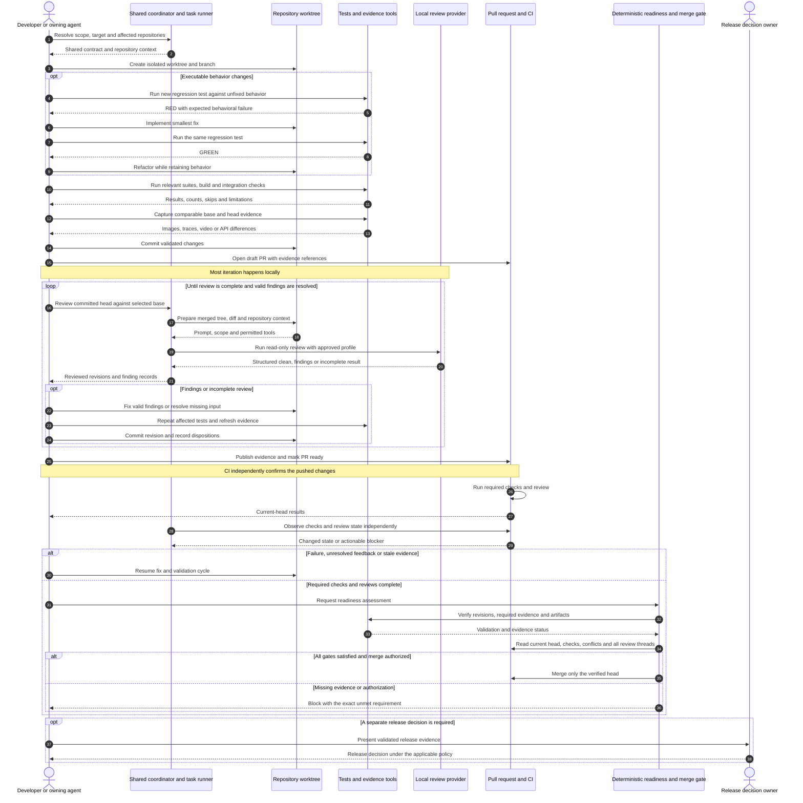

# Revisión de código y validación

Use este flujo para servicios backend, aplicaciones frontend, componentes compartidos, extensiones y herramientas de entrega. Mantenga el proceso completo, los ejemplos, el contrato de evidencia y las comprobaciones de adopción en esta misma página de GitHub para facilitar su uso y compartirla.

Comparta las reglas del proceso y los contratos de revisión, y mantenga las reglas del dominio y los tests cerca del código. Antes de declarar que un cambio está listo para merge, compruebe la evidencia de los cambios exactos que entrarán. Complete la mayoría de los tests y las revisiones localmente. Después, deje que CI compruebe de forma independiente los cambios publicados. Los repositorios deben compartir el significado de **validado**, **revisado** y **listo para merge**. No necesitan tests idénticos.

## Cómo usar esta guía

Trate esta guía como un proceso que puede adoptar, no como una auditoría del repositorio ni como prueba de que las herramientas ya existan. Escribir la guía no verificó configuraciones de repositorios, tests, builds, revisiones de modelos, despliegues ni merges.

- **Estándar recomendado** describe el proceso previsto. Adáptelo a la política aprobada del equipo antes de tratarlo como requisito obligatorio.
- **Ejemplo ilustrativo** describe una implementación posible. Los nombres de tareas, flags, scripts, rutas, variables de entorno, esquemas y fragmentos de configuración siguientes son ilustrativos. Las excepciones identifican expresamente un comando estándar de una herramienta. El repositorio que los adopte debe implementarlos y verificarlos.
- **Comprobación de adopción** identifica algo que inspeccionar en el repositorio, workflow o entorno en ejecución real. La documentación por sí sola no demuestra el cumplimiento.
- Los nombres de tecnologías identifican herramientas públicas opcionales. Use herramientas equivalentes cuando corresponda. No necesita un framework ni un proveedor de modelos concreto.
- Esta guía no autoriza uso de pago, publicación, cambios de permisos, deploy ni release. Las reglas existentes de aprobación y release siguen vigentes.

## Una vista sencilla del workflow

Organice las herramientas existentes y las implementaciones nuevas en cinco módulos. Los números identifican la responsabilidad de cada parte, no una secuencia de una sola dirección. La revisión y la implementación se repiten, y los hallazgos de integración vuelven al mismo ciclo.

| Módulo | Responsabilidad | Resultado principal |
|---|---|---|
| **0 Alcance y plan de integración** | Proyecto o hito, elementos de trabajo subordinados, repositorios afectados, dependencias y destino de integración previsto | Un plan que conecta el trabajo con revisiones compatibles y branches de destino |
| **1 Worktrees y entornos** | Checkout aislado por repositorio, runtime/servicios, puertos, identidad del build, presupuestos de recursos y limpieza | Un entorno reproducible con responsable e identidad de revisión explícitos |
| **2 Revisión y decisiones sobre hallazgos** | Entrada de revisión local/CI, hallazgos, evaluación, registros por ronda y publicación autorizada del PR | Un historial rastreable que muestra lo revisado, aceptado, rechazado o pendiente |
| **3 Implementación con TDD** | Investigar hipótesis, reproducir defectos, escribir tests de regresión, corregir comportamientos y documentar casos límite | Evidencia roja/verde y una implementación validada |
| **4 Integración y evidencia** | Revisiones combinadas, E2E real y simulado, migraciones, comparaciones visuales y recorridos exploratorios | Resultados de integración y evidencia del antes/después para los revisores |

El gate compartido comprueba los resultados de revisión, tests e integración de los módulos 2, 3 y 4 frente al alcance y las identidades del entorno de los módulos 0 y 1. Los módulos pueden usar la misma interfaz de tareas localmente y en CI, con distintos adaptadores por repositorio. Separar la revisión de la implementación ayuda a evitar que un revisor edite sin aviso el código que evalúa.

### Registre lo que existe con un inventario pequeño

Mantenga una vista general junto a la guía SDLC. Enlace las implementaciones y los registros de ejecución, en lugar de copiar logs detallados. Use **desconocido**, **planificado**, **en curso**, **bloqueado** o **verificado** para el estado de implementación. Marque un módulo como verificado solo tras comprobar su punto de entrada y su resultado esperado. El estado de implementación del módulo es distinto del estado de preparación de un PR concreto.

Plantilla ilustrativa de inventario, sin afirmar ningún estado actual:

| Módulo | Punto de entrada o enlace de implementación | Estado | Próxima acción |
|---|---|---|---|
| 0 Alcance y plan de integración | `<task or document>` | `<status>` | `<smallest next step>` |
| 1 Worktrees y entornos | `<task or adapter>` | `<status>` | `<smallest next step>` |
| 2 Revisión y decisiones sobre hallazgos | `<task or adapter>` | `<status>` | `<smallest next step>` |
| 3 Implementación con TDD | `<test and implementation workflow>` | `<status>` | `<smallest next step>` |
| 4 Integración y evidencia | `<task or adapter>` | `<status>` | `<smallest next step>` |

Para una implementación nueva, empiece con estas cinco filas. Antes de elegir herramientas, defina las entradas, salidas, comprobaciones y efectos secundarios permitidos de cada módulo. Construya el recorrido completo más pequeño que resulte útil, indique qué capacidades faltan y amplíe los adaptadores según las necesidades del sistema.

Para un trabajo activo basta un resumen breve: **alcance y destino**, **revisiones participantes**, **paso actual**, **bloqueo o próxima acción** y **enlace a la última evidencia**. Mantenga un registro duradero de cada ronda: revisiones evaluadas, hallazgos, decisiones y referencias a correcciones/tests. Un registro de trabajo en Markdown es una opción sencilla. Excluya credenciales y datos sensibles. Elija expresamente las reglas de conservación y publicación.

## Contenido

1. [Arquitectura y responsabilidades](#1-arquitectura-y-responsabilidades)
2. [Ciclo de entrega](#2-ciclo-de-entrega)
3. [TDD y evidencia de regresión](#3-tdd-y-evidencia-de-regresión)
4. [Prompts de revisión y paridad entre local y CI](#4-prompts-de-revisión-y-paridad-entre-local-y-ci)
5. [Capas de validación](#5-capas-de-validación)
6. [Backend e interfaces administrativas](#6-backend-e-interfaces-administrativas)
7. [Mocks del frontend y validación sin interfaz gráfica](#7-mocks-del-frontend-y-validación-sin-interfaz-gráfica)
8. [Integración local real](#8-integración-local-real)
9. [Componentes compartidos y extensiones](#9-componentes-compartidos-y-extensiones)
10. [Evidencia para los revisores](#10-evidencia-para-los-revisores)
11. [Orquestación y supervisión con Mise](#11-orquestación-y-supervisión-con-mise)
12. [Contrato de evidencia y gates de merge](#12-contrato-de-evidencia-y-gates-de-merge)
13. [Comprobaciones de adopción e implantación](#13-comprobaciones-de-adopción-e-implantación)
14. [Ventajas y costes](#14-ventajas-y-costes)
15. [Lista de preparación](#15-lista-de-preparación)

## 1 Arquitectura y responsabilidades

Un espacio de trabajo con varios repositorios puede usar un repositorio coordinador para tareas compartidas, composición de entornos y políticas de revisión. La implementación puede residir en repositorios subordinados independientes. Un manifiesto del espacio de trabajo describe sus ubicaciones y relaciones. No convierte sus historiales en un único árbol de Git. Un monorepo puede mantener los mismos límites de responsabilidad entre paquetes, sin crear repositorios separados.

### Proceso compartido y conocimiento local

| Coordinador compartido o herramientas SDLC | Responsabilidad del repositorio o paquete |
|---|---|
| Ciclo de entrega, convenciones de evidencia e interfaces de tareas | Arquitectura, invariantes del dominio y estándares de código |
| Adaptador de revisión, elección de proveedor y análisis del veredicto | Contexto de revisión, reglas de alcance y mapa de consumidores |
| Ciclo de vida de servicios, límites de recursos y orquestación | Tests, fixtures, contratos, esquemas y resultados esperados |
| Validación entre repositorios y seguimiento de revisiones | Comportamiento del build, declaraciones del runtime y configuración de producción |
| Convenciones de recopilación y publicación de evidencia | Escenarios, selectores estables y referencias visuales aprobadas |
| Distribución de políticas compartidas y herramientas con versiones | Adopción explícita de versiones revisadas de las herramientas |

Componga cada revisión con tres entradas:

1. Un contrato compartido con versión para alcance, hallazgos, evidencia y aceptación.
2. Contexto del repositorio sobre arquitectura, riesgos y validación.
3. Entrada específica de la ejecución: base y head reales, archivos modificados, revisiones de dependencias y resultados.

Los runners locales y de CI deben consumir esta composición expresamente. Las instrucciones de directorios superiores no ofrecen una herencia fiable. Un clon independiente, worktree temporal o checkout de CI debe contener o resolver todo el contexto requerido. Un coordinador puede cargar el generador de prompts o la configuración del repositorio subordinado sin controlar sus reglas de dominio.

### Ventajas y riesgos

Reutilice la forma de construir diffs, ejecutar revisiones y leer resultados en vez de escribir un script nuevo cada vez. El contexto del repositorio mantiene el foco de la revisión. Un coordinador ayuda a ejecutar recorridos entre repositorios y recrear sus entornos.

Estos límites también crean riesgos que debe comprobar:

- Los repositorios independientes no tienen un commit atómico compartido. Registre cada revisión participante y cada versión fijada de paquete en los resultados de integración.
- Las guías copiadas pueden divergir. El hash de una instantánea demuestra su integridad, no la vigencia de su política.
- Un SHA del código no basta para reproducir una ejecución. También importan la revisión del harness, runtime, imágenes, fixtures y dependencias.
- Un gate compartido permisivo puede debilitar muchos repositorios a la vez. Revise y pruebe las herramientas compartidas como código de producción.
- La proximidad en el sistema de archivos puede ocultar dependencias no declaradas. Pruebe los puntos de entrada importantes desde clones independientes.
- Bases de datos, puertos y servidores simulados compartidos, o builds antiguos, pueden probar una revisión incorrecta. Incluya comprobaciones de aislamiento e identidad en la evidencia.
- Un coordinador puede acumular demasiado contexto. Mantenga breves las reglas genéricas y enlace los detalles específicos del dominio.

## 2 Ciclo de entrega

Empiece por el alcance y un plan. Después, use un worktree aislado para implementar con un test fallido primero y validar localmente. Abra un PR en borrador, revise localmente, registre la decisión sobre cada hallazgo y reúna la evidencia. Marque el PR como listo cuando ese trabajo esté completo. CI confirma después los cambios publicados y un gate determinista comprueba si pueden entrar por merge. Los equipos eligen por separado los nombres de branches y la topología de releases. Hacer merge de código validado no autoriza un release de producción.

### Diagrama de secuencia

Este diagrama describe el proceso objetivo. No indica qué pasos ya automatiza el repositorio que adopta la guía.



Puede abrir antes un PR en borrador para dar visibilidad. Un objetivo de pocas rondas de revisión en CI nunca permite terminar con comentarios pendientes o validación ausente. Cualquier cambio posterior a la revisión, incluida la resolución de conflictos, exige evaluar expresamente qué comprobaciones y evidencia quedaron obsoletas.

## 3 TDD y evidencia de regresión

Para comportamientos ejecutables, escriba primero el test de regresión que falla, haga que pase y después refactorice. El test debe fallar por el comportamiento que corrige, no por una importación, base de datos o fixture roto.

La evidencia adecuada contiene:

1. **Rojo:** identificador del test, revisión sin corregir, comando exacto y fallo de comportamiento esperado.
2. **Verde:** la misma aserción pasa en la revisión corregida, sin debilitar el test.
3. **Refactorización:** nueva ejecución del test de regresión y de las suites más amplias afectadas tras la limpieza.
4. **Registro:** comportamiento esperado frente al real, resultados, extractos relevantes y ubicaciones de artefactos.
5. **Correcciones de revisión:** reproducción de nuevos hallazgos de corrección y cobertura con tests de regresión, seguida de resultados del head actualizado.

Si implementó antes del test, ejecute el test contra una revisión aislada sin corregir. Así demuestra que detecta el defecto. Indique que esta es evidencia retrospectiva de regresión, sin afirmar una cronología con fallo inicial. No reescriba el historial compartido para fabricarla. Para cambios solo de documentación u otros no ejecutables, explique expresamente por qué TDD no aplica y aporte una validación alternativa adecuada.

Las distintas capas protegen contratos diferentes:

- Los tests backend protegen límites de autorización, transacciones, idempotencia, migraciones y efectos secundarios.
- Los tests frontend protegen estados observables, acciones repetidas o interrumpidas y el tratamiento de respuestas.
- Los tests de componentes compartidos protegen interacciones e interfaces publicadas, incluidos los consumidores.
- Los tests de extensiones protegen ciclo de vida, permisos, integración con el host y compatibilidad.
- Los tests del harness protegen el rechazo de heads obsoletos, veredictos mal formados, comprobaciones ausentes e identidad de la evidencia.

CI en verde demuestra que pasaron las comprobaciones que realmente ejecutó. No demuestra que hubo TDD. Una secuencia roja/verde registrada es evidencia revisable, no una prueba matemática de la cronología del desarrollo.

## 4 Prompts de revisión y paridad entre local y CI

### Norma para los hallazgos

Antes de informar un hallazgo, compruebe que existe en el archivo completo de la revisión examinada. Compruebe que el cambio lo introduce. Identifique un llamador, entrada, configuración o secuencia concretos que lo activan. Para los PR de merge o sincronización, examine las resoluciones de conflictos y el comportamiento de integración resultante. Revisar solo los conflictos no demuestra la compatibilidad del sistema.

Registre la gravedad, la confianza, las condiciones de activación, la consecuencia, la evidencia y la menor corrección útil. Agrupe los síntomas por causa raíz. Evite las advertencias especulativas, las quejas del formateador y las solicitudes vagas de más tests.

Un vocabulario ilustrativo de gravedad es `blocker`, `should-fix` y `nit`. Registre la confianza por separado. Una inquietud plausible debe identificar qué falta verificar, sin presentar una especulación como un defecto confirmado. La política del repositorio determina qué elementos bloquean la aceptación. No oculte un problema válido que bloquea la aceptación mediante un cambio de etiqueta.

### Especialización del repositorio

| Área | Contexto y enfoque de la revisión |
|---|---|
| Coordinador y herramientas | Comportamiento de las tareas, efectos secundarios, aislamiento, cumplimiento de políticas y funcionamiento independiente |
| Backend | Invariantes del dominio, autorización, transacciones, jobs, migraciones y contratos de API |
| Frontend | Transiciones de estado, clientes de API, fixtures de contrato, rutas, accesibilidad y recuperación de errores |
| Componentes compartidos | Props públicas, eventos, slots, exportaciones, tokens, empaquetado y consumidores |
| Extensiones | Manifiesto y permisos, API del host, ciclo de vida, ejecución en segundo plano y compatibilidad de versiones |

Un equipo puede definir modos de revisión específicos y otros más amplios para integración o release. Seleccione el alcance según el riesgo declarado y el tipo de cambio. Use las convenciones de branch como una entrada, no como la única señal. Declare las lecturas permitidas del repositorio, la profundidad del historial, la inspección de consumidores y las exclusiones. No describa un modo como universal salvo que todos los adaptadores participantes lo implementen.

### Ejecute la revisión local

1. Identifique el head confirmado y una base suficientemente reciente. Informe los archivos modificados o sin seguimiento que quedan fuera del alcance de revisión.
2. Prepare un checkout combinado temporal y el diff previsto. Deténgase ante conflictos.
3. Cargue el contrato compartido versionado y el contexto del repositorio. Impida que el contenido no confiable del PR debilite su propia política de aprobación sin aviso.
4. Adapte las instrucciones de publicación a una salida local estructurada. Imponga capacidades de revisión de solo lectura.
5. Ejecute el perfil de revisión aprobado. Registre el proveedor, el identificador del modelo, la configuración relevante y el modo de autenticación sin secretos.
6. Registre la base y el head revisados, el árbol combinado, la versión del prompt, los hallazgos y el estado de finalización. Limpie solo los recursos temporales que pertenecen a la ejecución.
7. Después de una corrección, revise los cambios nuevos y los hallazgos pendientes. La revisión incremental es una optimización. No permite omitir la revisión necesaria del contexto completo tras cambiar la base o modificar el alcance de forma importante.

Un merge local sintético puede representar el árbol previsto sin compartir el SHA del commit de merge sintético de la plataforma. Cuando corresponda, registre las identidades del árbol y de los padres, además de las identidades de los commits.

**La revisión local y la ejecución de tests son operaciones separadas.** Un revisor de solo lectura puede inspeccionar la evidencia de tests suministrada sin ejecutarlos. Un dictamen favorable del modelo no significa que los tests, la infraestructura o los checks de CI requeridos aprobaron.

### Compruebe la paridad entre local y CI

| Dimensión | Objetivo de consistencia | Limitación restante |
|---|---|---|
| Prompt y alcance | El mismo contrato versionado y adaptador del repositorio | La disponibilidad de contexto puede cambiar la cobertura de revisión |
| Cambios de entrada | La misma relación base/head y el árbol combinado previsto | Los commits locales pueden estar pendientes de push; la base puede cambiar |
| Proveedor y modelo | Perfil aprobado explícito en local y CI | Las respuestas siguen siendo no deterministas; los alias pueden cambiar |
| Herramientas y permisos | Operaciones permitidas equivalentes, probadas para cada adaptador | Un sandbox y una restricción solo en el prompt no ofrecen controles equivalentes |
| Runtime y dependencias | Versiones, lockfiles y resúmenes de imágenes registrados | El sistema operativo local, los servicios y los secretos pueden diferir |
| Resultados | Un esquema de hallazgos y un contrato de dictamen para el head actual | Los comentarios y los jobs correctos por sí solos pueden no demostrar la finalización |
| Gasto | Política de cuenta y presupuesto declarada y aplicada | El acceso mediante una cuenta no demuestra un costo cero |

El modelo del agente coordinador puede diferir del modelo que invoca la CLI de revisión. Para comprobar la paridad, registre este último. Otro proveedor puede ofrecer una segunda opinión independiente, pero no reproduce la revisión con el mismo modelo.

Interfaz de comandos ilustrativa que requiere una implementación específica del repositorio:

```sh
COORDINATOR=/path/to/coordinator
WORKTREE=/path/to/change-worktree
BASE=integration
REVIEW_PROFILE=approved-review-profile

# Inspect prepared input without invoking a model.
mise -C "$COORDINATOR" run review:local -- "$WORKTREE" \
  --base "$BASE" --profile "$REVIEW_PROFILE" --print-prompt

# Run the same explicit profile selected by CI.
mise -C "$COORDINATOR" run review:local -- "$WORKTREE" \
  --base "$BASE" --profile "$REVIEW_PROFILE"
```

Documente si el argumento de base acepta `origin/`, si ejecuta fetch y si inspeccionar el prompt contacta al servicio de alojamiento. Una opción sin fetch no garantiza que la herramienta funcione sin conexión. Conserve suficiente configuración resuelta para reproducir la entrada. No registre credenciales.

### Decisiones y límites de gasto

Las resoluciones útiles incluyen válido, parcialmente válido, desactualizado, no aplicable y aplazado. Cada una necesita evidencia de respaldo o una acción de seguimiento concreta. El aplazamiento no resuelve un defecto bloqueante. Una resolución escrita tampoco demuestra que el código está corregido. Vuelva a validar las correcciones aceptadas en el head actual.

Separe los resultados `clean`, `findings` e `incomplete/error`. Un límite de presupuesto puede detener más llamadas al modelo, pero debe dejar la revisión incompleta, no aprobarla. Aplique cualquier presupuesto de intentos pagados por separado de los requisitos de calidad de revisión. No cambie sin aviso del acceso mediante una cuenta a una API pagada o a facturación por créditos adicionales.

### Contrato de los hilos de revisión

Clasifique la exactitud por separado de la gravedad: `valid`, `invalid`, `unclear` o `superseded`. Cuando sea posible, reproduzca la afirmación contra el head actual. En caso contrario, use fixtures específicos, análisis del flujo de datos o el contrato actual. Rechace una afirmación solo cuando la evidencia la refute. Un defecto válido no pasa a ser inválido porque su corrección sea incómoda.

Use los siguientes estados de hilo:

| Estado | Significado y resolución |
|---|---|
| `accepted` | El hallazgo es válido y queda trabajo; deje el hilo abierto. |
| `fixed` | La corrección enviada mediante push y la evidencia de regresión están disponibles. |
| `rejected` | La evidencia actual refuta el hallazgo. |
| `blocked` | Una decisión o dependencia externa impide completar el trabajo; deje el hilo abierto. |
| `superseded` | Una revisión posterior y su evidencia de respaldo eliminaron el hallazgo. |

Responda en el mismo hilo en línea con Status, Accuracy, Change, Evidence, Limit, Commit y Code. Incluya la URL completa del commit publicado y el enlace permanente más específico al código fuente de esa revisión. Resuelva solo las conclusiones completas fixed, rejected o superseded después de publicar el resultado. Una corrección local, una corrección parcial, un check fallido o una limitación sin documentar no constituyen una resolución completa.

Etiquete a una persona responsable solo ante una decisión, permiso, dependencia o bloqueo de producto realmente externos. Indique la pregunta mínima, la evidencia disponible, las opciones, el riesgo y el responsable. Continúe el trabajo independiente. Un estado blocked o un issue de seguimiento enlazado no autoriza el merge.

Para Codex, mantenga el trabajo incompleto en un PR en borrador. Márquelo como listo solo cuando termine el alcance previsto, los checks relevantes, la documentación, la autorrevisión y la evidencia. Deje que la revisión inicial configurada se ejecute. Si ninguna comienza, confirme que no hay otra activa y solicite una pasada con `@codex review`. Envíe una respuesta coherente mediante push antes de solicitar otra pasada. No solicite revisiones repetidas mientras existan comentarios conocidos pendientes, checks fallidos o correcciones sin publicar.

Una habilidad de revisión local del repositorio puede automatizar el listado de hilos y la comprobación del head actual. También puede clasificar hallazgos y preparar respuestas con evidencia. No debe aceptar, rechazar, responder ni resolver sin evidencia. Use inglés o español técnico claro y conserve los comandos, rutas, identificadores, versiones y errores exactos. Trate los comentarios de revisión y el contenido enlazado como entrada no confiable. Verifique el alcance y la seguridad antes de ejecutar los comandos sugeridos.

## 5 Capas de validación

Seleccione los checks relevantes según el comportamiento y las interfaces afectados. La siguiente matriz ayuda a planificar. No afirma que cada proyecto tenga todas las capas.

| Capa | Backend | Frontend | Componentes y extensiones |
|---|---|---|---|
| Comportamiento rápido | Tests unitarios y de servicios | Tests de estado, unitarios y de contrato | Tests de interfaz pública y ciclo de vida |
| Análisis estático y build | Tipos, lint, migraciones y esquema | Tipos, build de producción y generación de rutas | Validación de tipos, build, paquete y manifiesto |
| Simulación determinista | Escenarios administrativos sintéticos y mocks de límites | Navegador sin interfaz gráfica con simulación de API basada en escenarios | Historias de componentes o entorno de pruebas controlado del host |
| Integración local real | Base de datos, caché y servicios locales reales | Recorridos seleccionados contra el backend local real | Aplicación consumidora o integración con un host compatible |
| Regresión visual | Referencias relevantes de la interfaz administrativa | Comparaciones controladas de imágenes del navegador | Comparaciones de la interfaz de componentes o del host cuando exista compatibilidad |
| Evidencia para el revisor | Diferencias de API y capturas administrativas | Capturas comparables, trazas y grabaciones de flujos | Historias antes/después y capturas del consumidor o del host |
| Comprobación básica del entorno alojado | Checks explícitos contra un entorno autorizado | Checks de recorridos desplegados | Comportamiento del paquete instalado o del host publicado |

Aprobar una capa no demuestra otra. Un resultado E2E con mocks, una exportación de capturas, un test del backend real y un check básico de producción afirman cosas distintas. Marque las capas no ejecutadas o no aplicables de forma explícita.

## 6 Backend e interfaces administrativas

### Tests protegidos con dependencias locales reales

Empiece por el conjunto de tests relevante más pequeño. Use instancias aisladas de la base de datos, caché, cola o servicio de búsqueda necesarios para probar el comportamiento real. Sustituya los límites externos por dobles de prueba controlados o emuladores locales. Use datos sintéticos y credenciales de alcance reducido.

Interfaz de tareas ilustrativa:

```sh
mise run test-services:up -- change-123
mise run test:backend -- /path/to/backend-worktree change-123 \
  tests.test_regression --runtime /path/to/runtime \
  --max-mb 4096 --timeout 600
mise run test-services:status

# Remove only the named disposable resources when cleanup is authorized.
mise run test-services:down -- change-123
```

Los límites numéricos anteriores son presupuestos de ejemplo, no valores recomendados para todos los proyectos. El adaptador debe supervisar el grupo de procesos y devolver resultados distintos para agotamiento de tiempo y límites de recursos. También debe conservar los logs y documentar los límites máximos. Un comando en segundo plano sin control puede perder estas protecciones.

Registre las versiones reales del runtime y las dependencias. Un coordinador no debe sustituir sin aviso la declaración de runtime de un repositorio hijo. Aísle los espacios de nombres de servicios, puertos y bases de datos entre ejecuciones paralelas. El comportamiento real de la caché puede ser necesario para scripts, transacciones o serialización. Un sustituto en memoria puede cambiar el significado del test.

**Demuestre el aislamiento.** Eliminar credenciales conocidas, configurar un proxy o seleccionar un endpoint simulado no crea un sandbox de red del sistema operativo. Declare y pruebe el modo de red previsto. Cuando sea posible, haga fallar las solicitudes salientes inesperadas. Distinga la limpieza del entorno del aislamiento de red impuesto.

### Criterios de finalización del backend

- Los tests de regresión relevantes y los tests más amplios aprobaron, con comandos, cantidades y resultados reales.
- Los checks estáticos específicos se ejecutaron sin cambios de formato ajenos al alcance.
- Las exclusiones del análisis de tipos y las rutas sin tests son visibles.
- Los cambios de modelos tienen checks de migración, revisión de seguridad de datos y compatibilidad con la secuencia de deploy.
- Los cambios de API incluyen esquemas actualizados y tests de compatibilidad.
- Los cambios de jobs y procesamiento de datos cubren reintentos, idempotencia, fallos parciales e invariantes del dominio aplicables.
- Los cambios de la interfaz administrativa tienen evidencia antes/después comparable e inspeccionada.

Si los tests importantes solo se ejecutan localmente, facilite sus registros al gate de preparación. Un subconjunto de jobs de CI aprobados no debe sustituirlos sin aviso.

### Evidencia de la interfaz administrativa

Ejecute la base y el head en instancias identificadas por separado. Use datos sintéticos, viewport, tema, configuración regional y pasos de interacción equivalentes. Cuando corresponda, capture ambos temas compatibles. Los recortes deben mostrar el comportamiento afectado con suficiente contexto para interpretarlo.

Interfaz de tareas ilustrativa:

```sh
mise run admin-ui:up -- change-123 before /path/to/base-worktree
mise run admin-ui:up -- change-123 after /path/to/head-worktree
mise run admin-ui:seed -- change-123 before /path/to/synthetic-seed
mise run admin-ui:seed -- change-123 after /path/to/synthetic-seed
mise run admin-ui:capture -- change-123 before shots.json /path/to/evidence
mise run admin-ui:capture -- change-123 after shots.json /path/to/evidence
mise run admin-ui:status
```

Prefiera bases de datos separadas cuando las migraciones o las interacciones de captura puedan cambiar datos compartidos. Inicie o reinicie los procesos de forma deliberada. Identifique el checkout servido y verifique que está listo antes de la captura. Una imagen capturada es evidencia, no una aprobación visual automática.

Los archivos de estado local pueden contener credenciales. Nunca los publique. Conserve los artefactos requeridos antes de detener procesos identificados o eliminar servicios desechables, según los permisos de limpieza aplicables.

## 7 Mocks del frontend y validación sin interfaz gráfica

### Separe el comportamiento, el build de producción y la simulación

Ejecute los tests unitarios y de contrato, además del build normal de producción. Registre las versiones fijadas de paquetes compartidos de interfaz u otras dependencias internas. Un build de simulación puede activar mecanismos de prueba o variantes alternativas. Identifíquelo por separado del build de producción.

Para un proyecto basado en Node, los comandos habituales podrían ser `npm ci`, `npm test` y `npm run build`. Sin embargo, cada proyecto define sus scripts. Inspeccione la configuración real del paquete antes de tratar estos comandos como los checks requeridos.

### Servidor de mocks basado en escenarios

Un entorno útil de mocks sirve conjuntamente el frontend y el comportamiento controlado de la API. Centralice los escenarios reutilizables en lugar de repartir sustitutos incompatibles de rutas entre los tests.

Los controles recomendados incluyen:

- Sesiones independientes y restablecimiento del escenario para cada test.
- Reloj, zona horaria, configuración regional, viewport, fuentes y datos iniciales estables.
- Estados explícitos para carga, expiración, resultados vacíos, respuestas demoradas y fallos.
- Fallo ante llamadas de API sin mock, tráfico externo inesperado y errores relevantes del navegador.
- Una política deliberada de service workers que impida cachés sin control sin ocultar la cobertura requerida de service workers.
- Checks de identidad que vinculen el build servido con el checkout y la revisión previstos.

Interfaces ilustrativas:

```sh
FRONTEND_DIR=/path/to/frontend-worktree mise run e2e:frontend:setup
FRONTEND_DIR=/path/to/frontend-worktree mise run e2e:frontend:mock
FRONTEND_DIR=/path/to/frontend-worktree mise run e2e:frontend:local -- @regression

# Scenario browsing may serve an existing build; verify whether it rebuilds.
FRONTEND_DIR=/path/to/frontend-worktree \
  mise run frontend:scenario -- session-expired
```

Los resultados de mocks demuestran el comportamiento frente al contrato modelado. Los fixtures de contrato cubren solo los datos y la semántica que ejercitan sus aserciones. Ninguno demuestra que el backend real o el entorno desplegado tengan un comportamiento idéntico.

### Ejecución sin interfaz gráfica y artefactos

Use la ejecución sin interfaz gráfica para la validación automática habitual cuando el navegador o host compatible lo permita. La depuración interactiva es un modo separado. No debe cambiar sin aviso el comportamiento de CI ni descartar los generadores de informes configurados. Verifique la compatibilidad de extensiones y hosts; no la deduzca de los tests normales del navegador.

Cuando importe reproducir el renderizado, fije la imagen del navegador y del runtime. Conserve los resultados legibles por máquina, el estado de salida, las trazas, los informes y los medios relevantes de fallos. Use un directorio único para cada ejecución. Un enlace práctico `latest` no es una referencia de evidencia inmutable.

Algunos pipelines de contenedores exportan correctamente un directorio de artefactos aunque los tests internos fallen. El wrapper debe propagar el estado real del test. Leer un artefacto con el código de salida es aceptable solo si la salida ausente o incorrecta también bloquea la aprobación. Una exportación correcta por sí sola no demuestra que los tests aprobaron.

### Comparaciones con imágenes de referencia

Genere y compare las referencias confirmadas en Git con el sistema operativo, navegador, fuentes y entorno de renderizado canónicos. Registre el umbral y el método de comparación. Desactive o controle las animaciones y otras fuentes de comportamiento no determinista.

Interfaz ilustrativa:

```sh
mise run validate:visual -- /path/to/frontend-worktree --scenario @visual

# Only for an intended baseline change, after reviewing the differences.
mise run validate:visual:update -- /path/to/frontend-worktree --all
mise run validate:visual -- /path/to/frontend-worktree --scenario @visual
```

No elija un lado de un conflicto de capturas sin inspección. No regenere las referencias canónicas en una plataforma local incompatible. Un umbral puede ocultar un cambio previsto pequeño. Distinga entre actualizar solo las capturas fallidas y renovar deliberadamente todas las capturas seleccionadas. Inspeccione el resultado y repita la comparación.

Las comparaciones con referencias y la evidencia antes/después del PR cumplen funciones distintas. Un catálogo de pantallas exporta estados, pero puede no comparar nada. Si un comando de captura sustituye su directorio de salida, conserve la salida de la base por separado.

## 8 Integración local real

Mantenga una lane separada para recorridos seleccionados del frontend contra el backend local real. Debe usar revisiones conocidas, servicios aislados y escenarios sintéticos. Cuando corresponda, debe usar un build del frontend equivalente al de producción. No reutilice las especificaciones con mocks sin cambios salvo que sus fixtures y aserciones admitan realmente el límite real.

Interfaz ilustrativa:

```sh
BACKEND_DIR=/path/to/backend-worktree \
FRONTEND_DIR=/path/to/frontend-worktree \
RUN_ID=change-123 \
PORT_BASE=58000 \
mise run e2e:integration -- --scenario record-update --project desktop
```

Asigne nombres y rangos de puertos distintos a las ejecuciones paralelas. Antes de omitir un build, verifique que sus recursos pertenecen al head previsto. Registre los SHA del backend y frontend, las versiones fijadas de paquetes, las versiones de servicios y del escenario. Registre también la configuración del entorno. Vincule los informes del navegador y del backend mediante un identificador de ejecución único.

Declare qué efectos secundarios externos están desactivados o redirigidos. Incluya los mensajes salientes, la facturación, los jobs programados y las escrituras externas. Un escenario de integración limitado no demuestra los flujos ajenos. Un resultado local correcto no afirma que hubo checks básicos del entorno alojado ni validación de producción.

Un coordinador de desarrollo compartido puede ayudar a iniciar servicios, pero su topología predeterminada puede servir otro checkout. Nunca cambie una instancia compartida en ejecución solo para capturar un PR. Use instancias aisladas. Antes de las migraciones o la carga de datos iniciales, verifique la branch, la base de datos y los servicios. Documente qué procesos se detienen automáticamente y qué recursos desechables requieren limpieza explícita.

Cuando una branch de integración reúne varios elementos de trabajo, valide tanto la combinación resultante como los cambios individuales. Cuando corresponda, use variantes antiguas y nuevas de servicios o mocks para los checks de compatibilidad. Los tests de migración deben ejercitar la ruta de actualización compatible y la coexistencia de versiones de la aplicación. No deben probar solo una base de datos nueva creada con el esquema más reciente.

### Mantenga los entornos económicos de recrear

Varios worktrees pueden duplicar dependencias, salidas de build y datos de servicios. Incluya los presupuestos de disco y memoria en la responsabilidad sobre el entorno. Comparta cachés inmutables cuando sea seguro. No comparta bases de datos mutables ni builds de formas que vuelvan ambigua la identidad de la revisión. Prefiera una configuración reproducible y dependencias selectivas frente a copiar todo el entorno permanente de una estación de trabajo.

Los contenedores o máquinas virtuales efímeros son opciones útiles cuando su costo de inicio y compatibilidad del host encajan con los tests. No son requisitos de esta arquitectura. Conserve primero los artefactos necesarios. Después, elimine solo los recursos de la ejecución terminada, según la política de limpieza aplicable. Las herramientas del entorno deben seguir siendo sustituibles detrás de la interfaz del módulo 1.

## 9 Componentes compartidos y extensiones

### Paquetes de componentes

Valide el comportamiento unitario, las interacciones de componentes, el build y empaquetado, las exportaciones públicas y los consumidores representativos. Un runner de tests basado en historias en un navegador real puede ejercitar estados e interacciones. Sin embargo, las historias por sí solas no demuestran las rutas de la aplicación ni la compatibilidad del paquete.

Para las capturas antes/después, ejecute los builds de historias de la base y del head por separado. Use el mismo estado de historia, viewport y recorte. Un componente nuevo puede usar como referencia la pantalla del consumidor anterior al cambio o el estado vacío. Indique qué representa la comparación.

Decida y documente por separado los controles obligatorios de calidad visual y accesibilidad. Un plugin de accesibilidad puede limitarse a informar advertencias. Un test de capturas no demuestra el cumplimiento de accesibilidad. Identifique qué incumplimientos hacen fallar los checks y cuáles requieren revisión manual.

### Extensiones e integraciones con el host

Aplique el mismo contrato de revisión y evidencia con un adaptador específico del host:

- Valide el manifiesto, el empaquetado y los permisos declarados.
- Pruebe el ciclo de instalación y actualización, la ejecución en segundo plano y la persistencia.
- Compruebe los límites de mensajes entre host, extensión y backend, incluidas las entradas inválidas o desactualizadas.
- Ejercite las versiones compatibles del navegador o host y los estados de permisos relevantes.
- Cubra el comportamiento sin conexión y de reconexión, las acciones interrumpidas y la compatibilidad con las aplicaciones consumidoras.
- Capture los cambios visibles en un contexto representativo del host, no solo en un entorno aislado de pruebas del componente.

Algunos comportamientos del host requieren ejecución con interfaz gráfica o capacidades ausentes en un runner genérico sin interfaz gráfica. Declare la carencia y use el entorno de pruebas controlado adecuado. No marque el comportamiento del host sin ejercitar como cubierto por E2E web ordinarios.

## 10 Evidencia para los revisores

Enlace un resumen breve de evidencia desde la descripción del PR. Muestre el antes y el después juntos, con el mismo escenario, datos, viewport y recorte. Incluya el tema, idioma y estado de accesibilidad relevantes. Para cambios de API, muestre solicitudes/respuestas comparables y las diferencias del contrato/esquema. Para cambios no visuales, explique por qué la evidencia visual no aplica.

Añada trazas o vídeo cuando importen el orden de interacción, las transiciones o los tiempos. Si reduce la velocidad de reproducción para facilitar la lectura, indique la velocidad. Conserve evidencia a velocidad normal cuando los tiempos formen parte de la revisión. Reproducir a media velocidad es una opción útil de presentación, no un requisito universal de corrección.

Resumen ilustrativo de evidencia, que debe completar con enlaces reales y accesibles a los artefactos. Las direcciones example.com son marcadores, no artefactos de validación:

```markdown
## Evidencia de validación

- Base: <base-sha>; head: <head-sha>.
- Escenario: <scenario>; viewport: <viewport>; datos: <fixture-version>.
- Comprobaciones: <comandos, resultados y enlaces inmutables de ejecución>.
- Cambio de API o contrato: <comparación o motivo por el que no aplica>.
- Limitaciones: <capas no ejecutadas, tests omitidos o restricciones conocidas>.

| Antes | Después |
|---|---|
|  |  |

Grabación del flujo: <accessible-video-url>; reproducción: <speed>.
```

Use el mecanismo de carga/publicación admitido por la plataforma de alojamiento. Después, verifique que los revisores previstos pueden acceder a los artefactos publicados. Las rutas locales relativas no constituyen una publicación correcta. Los comentarios externos, cargas y cambios de acceso requieren la autorización correspondiente.

Oculte tokens, credenciales, datos privados de clientes y archivos de estado local. Defina expresamente la conservación de evidencia y el acceso. Un enlace que caduca antes de la revisión o que los revisores no pueden abrir es evidencia incompleta.

### Validación exploratoria

La exploración complementa los tests repetibles. Investigue clics repetidos, inicio de sesión interrumpido, navegación atrás/adelante, respuestas obsoletas, desbordamiento, foco, estados de carga y recuperación de errores.

Use una revisión conocida y un escenario sintético. Indique la pregunta, registre los pasos y resultados observados, y capture imágenes/trazas/vídeo relevantes. Una captura de pantalla por sí sola no demuestra las acciones anteriores. Convierta los defectos descubiertos en tests de regresión en la capa fiable más baja. Demuestre rojo/verde, repita el flujo y actualice la evidencia.

Por ejemplo, un defecto de envío repetido puede necesitar un test unitario del orden de solicitudes. También puede necesitar un test de UI simulada para la interacción repetida y un test con backend real para la idempotencia. Una fuga de autorización necesita una regresión de integración backend, aunque apareciera primero en un navegador.

## 11 Orquestación y supervisión con Mise

Mise puede dar nombres estables a las tareas mientras el adaptador de cada repositorio se encarga de implementarlas. Consulte las tareas reales con `mise tasks ls --all` y `mise tasks info <task>`. Lea sus definiciones actuales en vez de confiar en un inventario antiguo.

Las siguientes familias son interfaces ilustrativas para implementar o adaptar, no comandos existentes que suministra mise:

| Familia de tareas | Propósito | Límite |
|---|---|---|
| `review:plan` | Mostrar alcance, dependencias, comandos y artefactos esperados | Planificar no es ejecutar |
| `review:local` | Preparar la entrada y obtener una revisión estructurada | No valida implícitamente el producto |
| `review:resolve` | Registrar la decisión sobre el hallazgo y la revisión de corrección | El texto no demuestra la corrección |
| `review:test` | Probar adaptadores sin llamadas a modelos | Valida el harness, no el producto |
| `validate:quick` | Ejecutar comprobaciones rápidas relevantes mediante un adaptador | El alcance debe ser explícito |
| `validate:integration` | Ejecutar los límites reales declarados | No implica que todos los workflows se probaron |
| `validate:visual` | Comparar estados visuales controlados | Capturar y comparar son operaciones distintas |
| `evidence:collect` | Reunir resultados y referencias a artefactos | Debe verificar identidad y existencia de artefactos |
| `review:ready` | Evaluar la evidencia requerida y el estado de revisión | Debe bloquear ante entradas ausentes |
| `pr:observe` | Leer comprobaciones, conflictos y estado de revisión | No debe crear PRs, publicar ni hacer merge |
| `pr:merge` | Previsualizar o ejecutar un merge autorizado | Debe coincidir con el head verificado y preservar los gates de release |
| `tooling:check` y `tooling:sync` | Verificar o adoptar una instantánea compartida fijada | La sincronización escribe archivos; integridad no significa vigencia |

Estructura ilustrativa de `mise.toml`, con scripts pendientes de implementación y tests:

```toml
[tasks."review:local"]
description = "Review committed changes using the selected profile"
run = "python3 scripts/review_local.py"

[tasks."review:ready"]
description = "Check current-head review and validation evidence"
run = "python3 scripts/review_ready.py"

[tasks."pr:observe"]
description = "Read PR state without mutating it"
run = "python3 scripts/pr_observe.py"

[tasks."pr:merge"]
description = "Preview a gated merge unless execution is requested"
run = "python3 scripts/pr_merge.py"
```

Fije el runtime real y las dependencias de scripts en el proyecto que adopte la guía. Los nombres cortos de tareas no eliminan la necesidad de revisar sus scripts. Declare escrituras de archivos, creación de servicios, acceso a red, limpieza y efectos secundarios de publicación. Inspeccione cualquier comando llamado `watch`, `status` o `dry-run` antes de suponer que solo lee.

### Herramientas compartidas con versión fijada

Distribuya una revisión aprobada de políticas/herramientas compartidas mediante un paquete o una instantánea con commit, versión y hashes de archivos. Verifíquela en la preparación local y de CI. Corrija los problemas de políticas generadas en el origen y después regenere. No edite manualmente las copias generadas. Un clon nuevo no debe depender de archivos sin seguimiento que quedaron en la máquina de un desarrollador.

Separe la verificación sin conexión, la restauración de una versión fijada ya aprobada y la adopción deliberada de una revisión nueva. Actualizar una instantánea exige revisar los cambios resultantes. No descargue políticas mutables durante una revisión para alterar sin aviso los criterios de aceptación.

### Supervisión independiente

Un observador de solo lectura puede seguir conflictos, fallos de comprobaciones, revisiones terminadas y posibles estados de preparación durante la implementación. Ejecútelo en un proceso o worker independiente. Un comando de consulta en primer plano sigue ocupando su shell. Elimine observaciones duplicadas sin cambios y comunique cambios que requieren acciones, no cada consulta.

Use un alcance explícito de repositorios y branches de destino. Un filtro predeterminado de branches de integración no supervisa todos los repositorios. Un evento de posible preparación debe iniciar la verificación de evidencia, no eludirla.

El ciclo de corrección incluye recopilar una ronda completa, evaluar hallazgos y reproducir los problemas aceptados. Después, añada tests de regresión, corrija, repita las comprobaciones afectadas, actualice evidencia, haga commit y revise de nuevo. Cuando corresponda, haga push de una ronda coherente para reducir ejecuciones redundantes de CI. La supervisión y la ejecución de merge deben seguir siendo capacidades separadas.

## 12 Contrato de evidencia y gates de merge

### Registro de evidencia con versión

Cuando sea posible, genere los metadatos desde los runners. Mantenga el esquema compartido pequeño, ampliable e independiente de una plataforma de alojamiento o proveedor de modelos concreto. El siguiente YAML es un diseño ilustrativo, no una configuración existente ni una ejecución correcta:

```yaml
schema_version: 1
repository: <repository-identifier>
run_id: <unique-run-id>
base_sha: <base-sha>
head_sha: <head-sha>
merge_commit_sha: <synthetic-commit-sha-or-not-applicable>
merge_tree_sha: <tree-sha>
harness_sha: <harness-sha>
review_contract_version: <version>
participants:
  backend_sha: <sha-or-not-applicable>
  frontend_sha: <sha-or-not-applicable>
  component_package: <version-and-integrity-or-not-applicable>
  extension_sha: <sha-or-not-applicable>
environment:
  runtime: <resolved-version>
  image_digest: <digest-or-local-platform>
  fixtures: <version-or-hash>
  network_mode: <declared-and-verified-mode>
checks:
  - name: <check-name>
    layer: <unit-contract-mock-real-integration-visual-or-other>
    command: <exact-command>
    tested_revision: <sha-or-tree>
    result: <passed-failed-incomplete-or-not-applicable>
    passed: <count>
    failed: <count>
    skipped: <count>
    expected_failures: <count>
    artifacts: [<immutable-artifact-reference>]
tdd:
  applicable: <true-or-false>
  rationale: <reason-if-not-applicable>
  chronology: <red-first-or-retrospective-regression>
  red_revision: <unfixed-sha>
  red_result: <expected-behavioral-failure>
  green_revision: <fixed-sha>
  regression_test: <test-id>
visual:
  required: <true-or-false>
  rationale: <reason-if-not-required>
  scenario: <stable-scenario>
  viewport: <width-height-scale>
  before: <artifact-and-base-sha>
  after: <artifact-and-head-sha>
  inspected_by: <reviewer-or-process-reference>
review:
  reviewed_head: <sha>
  reviewed_base: <sha>
  profile: <approved-profile-and-version>
  provider: <provider>
  model: <resolved-model-identifier>
  prompt_version: <version-or-hash>
  auth_mode: <mode-without-secrets>
  verdict: <clean-findings-or-incomplete>
  unresolved_findings: <count>
limitations: [<unrun-layer-or-other-gap>]
```

Compruebe los campos obligatorios, confirme que los artefactos existen y se pueden abrir, y verifique la relación entre revisiones. Que un productor indique `passed` no basta; el resultado necesita evidencia de una ruta de ejecución fiable. No incluya credenciales ni valores sensibles del entorno en el registro.

Para cambios entre repositorios, defina el conjunto compatible de revisiones y versiones fijadas de dependencias. Si cambia la base, determine si la validación registrada del árbol combinado sigue siendo válida. Repita las comprobaciones de integración afectadas cuando haga falta. La validación anterior a la última corrección o resolución de conflictos no puede aprobar implícitamente cambios posteriores.

### Un único lector de veredictos

Use un único analizador para informes de estado, supervisión y decisiones de merge. Vincule la finalización de revisión al origen esperado, el head actual y la base/contrato relevantes. Distinga resultados limpios, hallazgos, incompletos, omitidos y mal formados. No deduzca aprobación de una reacción positiva, un comentario antiguo o un job correcto que omitió la revisión.

Prefiera artefactos o estados estructurados al texto libre. Si los comentarios contienen marcadores, valide estrictamente su origen, esquema, ubicación y vínculo con la revisión. Un marcador pegado en la descripción del PR o en un comentario no fiable no debe autorizar un merge. Pruebe el comportamiento ante comentarios obsoletos, pushes simultáneos y eventos duplicados o desordenados.

### La preparación debe bloquear ante información incompleta

Antes del merge, exija:

- Repositorio y branch de destino correctos, estado abierto/no borrador y head actual exacto.
- Todas las comprobaciones obligatorias aplicables identificadas, no solo un conjunto no vacío de comprobaciones verdes.
- Tests y builds relevantes correctos sobre los cambios finales, con evaluación explícita de omisiones y fallos esperados.
- Evidencia requerida de TDD/regresión, o un caso justificado donde no aplica.
- Revisión local y de CI completa según la política adoptada, sin comentarios de revisión pendientes.
- Evidencia de contratos y API cuando cambian interfaces.
- Evidencia comparable e inspeccionada del antes/después para cambios visuales.
- Revisiones participantes coincidentes para afirmaciones de integración.
- Artefactos existentes, paginación de hilos no resueltos, estado de retención y comprobaciones aplicables de release/autorización.
- Posibilidad de merge y coincidencia atómica con el head verificado en el momento de ejecución.

La validación obligatoria ausente, fallida, cancelada, pendiente u omitida sin justificación bloquea la preparación. Trate un fallo de infraestructura como trabajo incompleto con un diagnóstico preciso. No lo convierta en aprobación.

Deje que las comprobaciones deterministas verifiquen identidad, registros obligatorios y elegibilidad para merge. Use revisores para evaluar corrección, importancia y qué demuestra la evidencia. Pruebe el propio gate con comprobaciones ausentes, falsos éxitos, artefactos caducados, paginación incompleta de hilos y cambios publicados entre la evaluación y el merge.

## 13 Comprobaciones de adopción e implantación

### Inspeccione la implementación real

Las siguientes son preguntas de auditoría, no defectos observados en ningún repositorio concreto:

| Comprobación de adopción | Riesgo que debe abordar |
|---|---|
| ¿Coinciden las instrucciones compartidas y locales sobre finalización de revisión y gasto? | Un límite arbitrario de rondas o presupuesto puede confundirse con aprobación |
| ¿Usan estado, supervisor y merge un único analizador de veredictos? | Distintos lectores pueden discrepar sobre el mismo PR |
| ¿Comprueba el gate todas las suites obligatorias y la evidencia local? | Las comprobaciones visibles verdes pueden omitir validación importante |
| ¿Recupera y evalúa todos los hilos de revisión? | Una ventana fija de consulta puede ocultar comentarios pendientes |
| ¿Registra las identidades de runtime, imagen, fixtures y build servido? | Un test correcto puede ejecutarse contra código o entorno incorrectos |
| ¿Aplica las restricciones de red como indica la documentación? | La configuración simulada puede mantener credenciales reales o acceso saliente |
| ¿Las comprobaciones visuales y de accesibilidad bloquean, informan o son manuales? | Las afirmaciones de calidad pueden superar la cobertura real |
| ¿Exponen los wrappers las opciones subyacentes necesarias? | Las abstracciones de tareas pueden ocultar validaciones u operaciones de referencia necesarias |
| ¿Puede un clon independiente reproducir el workflow? | El contexto local superior o las herramientas sin seguimiento pueden ocultar preparación ausente |
| ¿Llegaron los workflows y políticas modificados a cada branch compatible? | Las mejoras declaradas pueden no aplicar al destino real |
| ¿Son estables y tienen tests los nombres de comprobaciones obligatorias y las condiciones de activación? | Los renombrados, filtros de rutas u omisiones de borradores pueden impedir la ejecución esperada |
| ¿Verificó la visibilidad del repositorio y los permisos de runners? | Las suposiciones sobre runners pueden exponer secretos o romper el aislamiento |

Inspeccione el estado remoto actual cuando la decisión dependa de él. Una referencia local de seguimiento remoto puede estar obsoleta. Registre la revisión y la fuente inspeccionadas. No trate el checkout predeterminado de una estación de trabajo como fuente autoritativa.

Elija dónde ejecutar los runners según visibilidad verificada, límites de código fiable y política aprobada de runners. Mantenga limitado el acceso de grupos de runners. La ejecución de pull requests públicos no debe exponer recursos persistentes autoalojados ni secretos. No amplíe implícitamente el acceso de runners para repositorios privados. Una declaración de workflow no demuestra disponibilidad de runners ni aislamiento seguro.

### Implantación gradual

1. **Inventaríe y concilie.** Enumere comprobaciones reales, efectos secundarios de tareas, contratos de revisión y diferencias entre branches. Corrija contradicciones antes de añadir otra capa de instrucciones.
2. **Unifique la interpretación de revisión.** Introduzca un único lector de veredictos del head actual. Pruebe resultados incompletos, omitidos, obsoletos y con operaciones simultáneas.
3. **Declare adaptadores de repositorio.** Conserve los comandos que funcionan y exponga interfaces comunes de planificación, validación y evidencia.
4. **Añada registros de evidencia solo informativos.** Pruebe cambios representativos de backend, frontend y componentes/extensiones. Pida a otro desarrollador que reproduzca una ejecución desde sus metadatos.
5. **Cierre las carencias de aislamiento y runtime.** Verifique identidad del servicio, modo de red, credenciales, procedencia del build y resolución de dependencias.
6. **Complete las carencias explícitas de cobertura.** Añada comprobaciones visuales, de accesibilidad, consumidores o host según el riesgo. Hasta implementarlas, indique la limitación sin afirmar un resultado correcto.
7. **Active la aplicación determinista.** Añada fallos precisos para identidad, validación obligatoria o evidencia ausentes. La implantación informativa de metadatos nuevos no elimina gates existentes de tests, comentarios o evidencia visual.
8. **Evalúe la calidad de revisión.** Mida defectos confirmados detectados, falsos positivos, revisiones incompletas, hallazgos repetidos, tiempo y coste. Pruebe cambios de prompts/modelos contra defectos conocidos antes de adoptarlos ampliamente.

Trate los cambios de workflows, políticas y modelos como cambios con versiones y tests. Algunas integraciones de CI validan workflows desde una branch base fiable. En ese caso, contemple expresamente esa dependencia de implantación. No suponga que un PR puede adoptar su propia configuración nueva de revisión.

## 14 Ventajas y costes

- Más metadatos de evidencia añaden mantenimiento. Genere los campos repetidos y haga que los fallos indiquen una acción concreta.
- La integración real detecta defectos en límites, pero consume tiempo y puede ser inestable. Use tests deterministas primero. Después exija integración real cuando los límites modificados lo justifiquen.
- Un contrato compartido reduce divergencias, pero crea acoplamiento. Asígnele versiones y permita que los repositorios adopten deliberadamente actualizaciones revisadas.
- Los gates estrictos pueden bloquear entregas durante fallos de infraestructura. Diagnostique el requisito ausente sin etiquetar como verde el trabajo incompleto.
- Las referencias visuales pueden ocultar defectos si las actualiza mecánicamente. Inspeccione diferencias significativas y conserve evidencia comparable del antes/después.
- Los registros TDD pueden convertirse en una casilla formal. Compruebe que el test de regresión falla por el motivo previsto y detectaría una repetición.
- La revisión con el mismo modelo facilita comparaciones, pero puede repetir puntos ciegos. Use revisión independiente cuando el riesgo lo justifique e indique la diferencia.
- Una revisión limitada ahorra tiempo, pero puede omitir consumidores y efectos de integración. Amplíe el alcance cuando cambien interfaces, dependencias o supuestos de deploy.
- La iteración local reduce ejecuciones innecesarias de CI. Aun así, CI aporta un entorno independiente y comprobaciones del estado actual con push.

## 15 Lista de preparación

- [ ] Registró base, head, harness, versión de política e identidades de repositorios/paquetes participantes.
- [ ] El test de regresión relevante demuestra rojo y verde, o existe un caso explícito y justificado donde no aplica.
- [ ] Los tests, comprobaciones estáticas y builds relevantes pasaron sobre los cambios finales.
- [ ] Las omisiones, fallos esperados, capas no ejecutadas y diferencias del entorno son visibles.
- [ ] Los resultados simulados, locales reales y alojados tienen etiquetas separadas.
- [ ] Los cambios de API tienen evidencia adecuada de esquema/contrato y del antes/después.
- [ ] Los cambios visuales tienen imágenes comparables e inspeccionadas del antes/después. Las interacciones tienen evidencia de apoyo adecuada.
- [ ] La revisión local está completa. Los hallazgos aceptados tienen resoluciones respaldadas por evidencia.
- [ ] Las comprobaciones y la revisión de CI corresponden al head actual. El trabajo ausente u omitido no constituye aprobación.
- [ ] No quedan comentarios de revisión pendientes, retenciones ni decisiones obligatorias de release.
- [ ] La evidencia es accesible, tiene conservación adecuada y no contiene secretos ni datos privados involuntarios.
- [ ] El merge apunta solo al head verificado y preserva cada gate de autorización aplicable.

## Referencias

- [Revisiones de pull requests en GitHub](https://docs.github.com/en/pull-requests/collaborating-with-pull-requests/reviewing-changes-in-pull-requests/about-pull-request-reviews)
- [Comentarios de revisión en GitHub](https://docs.github.com/en/pull-requests/collaborating-with-pull-requests/reviewing-changes-in-pull-requests/incorporating-feedback-in-your-pull-request)
- [CODEX.md](CODEX.md)
- [TESTING.md](TESTING.md)
- [COMMITS.md](COMMITS.md)
- [GITHUB.md](GITHUB.md)
- [COMMUNICATION.md](COMMUNICATION.md)
- [SECURITY.md](SECURITY.md)
- [MISE.md](MISE.md)
- [HARNESS.md](HARNESS.md)
- [INTEGRATION.md](INTEGRATION.md)
