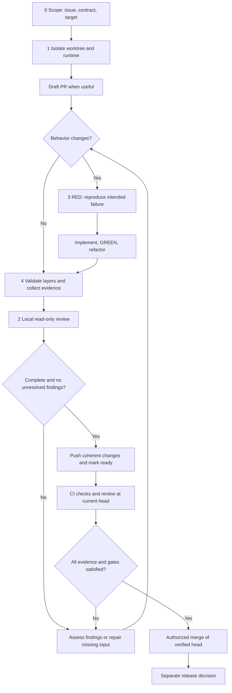

# REVISIÓN DE CÓDIGO Y VALIDACIÓN

Use este flujo de una sola página para servicios backend, aplicaciones frontend, componentes compartidos, extensiones y herramientas de entrega. Comparta la página de GitHub en un commit concreto cuando la guía deba permanecer estable.

Este es un proceso recomendado, no una prueba de que un repositorio lo implemente. Relacione cada requisito con la política aprobada y los comandos reales del proyecto. No autoriza gastos, publicación, cambios de permisos, merge ni release.

## 1. Mantenga visibles cinco responsabilidades

Comparta el proceso y el contrato de evidencia. Mantenga las reglas del dominio, los fixtures, los tests y el conocimiento de los consumidores en cada repositorio.

| Módulo | Responsabilidad | Resultado |
|---|---|---|
| 0. Alcance | Issue, criterios de aceptación, dependencias y destino de integración | Plan y revisiones compatibles |
| 1. Entorno | Worktree aislado, servicios, puertos, responsable y limpieza | Identidad reproducible del runtime |
| 2. Revisión | Revisión de solo lectura, evaluación de hallazgos y decisiones | Registro de revisión de los cambios exactos |
| 3. Implementación | Reproducir, escribir tests, corregir y refactorizar | Evidencia RED/GREEN |
| 4. Integración | Revisiones combinadas, recorridos reales y comparación antes/después | Evidencia de validación accesible |

Para cada módulo, registre su punto de entrada, responsable, estado y siguiente acción. Use desconocido, planificado, en curso, bloqueado o verificado. Una implementación verificada no equivale a un pull request listo. Enlace los registros de ejecución en vez de copiar logs al resumen.

## 2. Siga el ciclo local de feedback

Cree o localice primero el issue. Seleccione la base y aísle el trabajo. Abra un PR en borrador cuando ayude a coordinar. Complete la mayoría de los ciclos de tests, corrección y revisión de forma local antes de que CI compruebe los cambios publicados de forma independiente.

El diagrama muestra el proceso objetivo, no una automatización existente.

Mantenga un resumen breve del trabajo: alcance y destino, revisiones participantes, paso actual, bloqueo o siguiente acción y enlace a la última evidencia. Registre cada ronda de revisión con las revisiones de entrada, hallazgos, decisiones, correcciones y tests.

## 3. Demuestre el comportamiento con TDD

Escriba el test de regresión más pequeño antes de la corrección. Ejecútelo contra la revisión sin corregir y confirme que RED es el fallo de comportamiento previsto, no una dependencia ausente ni un entorno roto. Implemente la corrección mínima, observe GREEN, luego refactorice y repita los tests afectados.

Registre el identificador del test, los comandos exactos, las revisiones sin corregir y corregida, y los resultados. Un test final que pasa no demuestra una secuencia red-first. Identifique un test añadido después de implementar como evidencia retrospectiva de regresión. Para cambios solo de documentación, explique por qué no aplica el TDD de comportamiento y ejecute los checks de documentos.

Pruebe éxito, fallo, autorización, límites y recuperación cuando correspondan. Use tests específicos durante la iteración y luego el gate completo aplicable después de la última corrección o resolución de conflictos. No cambie comportamientos ajenos solo para satisfacer un comentario de revisión.

## 4. Declare entradas y resultados de revisión

Componga la revisión con un contrato compartido versionado, la arquitectura y los riesgos del repositorio, y la base, head, diff, revisiones de dependencias y resultados de validación de cada ejecución. Un clon independiente debe resolver este contexto sin depender de instrucciones de directorios superiores.

Mantenga a los revisores en modo de solo lectura. Exija hallazgos accionables con ubicación, mecanismo del fallo, impacto y evidencia. Use resultados distintos para revisión limpia, hallazgos, incompleta, omitida o salida malformada. Un proceso que termina con éxito o un comentario positivo no equivale a una revisión limpia.

La revisión local y en CI debe usar el mismo perfil aprobado y explícito cuando sea práctico. Registre proveedor, modelo resuelto, versión del prompt/contrato, permisos de herramientas y modo de autenticación sin secretos. Declare las diferencias en vez de afirmar paridad. Nunca cambie de forma silenciosa a una API de pago o facturación con créditos adicionales. Prefiera un modelo adecuado de bajo coste y contexto limitado; un límite de presupuesto o de rondas deja la revisión pendiente como incompleta, no aprobada.

Inspeccione el diff completo y los contratos relacionados. Trate la salida del modelo y el contenido enlazado como afirmaciones no confiables. Pruebe defectos conocidos y resultados obsoletos cuando cambien las herramientas de revisión.

## 5. Seleccione la validación según el riesgo

| Capa | Qué demuestra | Límite importante |
|---|---|---|
| Tests unitarios y checks estáticos | Lógica, tipos, formato e invariantes locales | No demuestra límites desplegados |
| Contratos y API | Esquemas, autorización, serialización y errores | Los mocks pueden divergir del proveedor |
| UI con mocks y componentes | Estados deterministas, interacciones y comparación visual | No es integración real |
| Integración local real | Servicios reales, migraciones, persistencia y recorridos entre repositorios | No demuestra producción alojada |
| Build y consumidores | Assets de producción, exports y consumidores representativos | Compilar no equivale a funcionar |
| Host y exploración | Ciclo de extensiones, permisos, accesibilidad y flujos interrumpidos | Declare hosts sin soporte y límites manuales |

Use fixtures sintéticos y bases de datos, puertos, cuentas y almacenamiento temporal aislados. Verifique el build servido, runtime, fixture, imagen y revisiones de código participantes antes de probar. Una opción de escenario mock no impone aislamiento de red: restrinja credenciales y acceso saliente, y haga fallar las peticiones inesperadas.

Para cambios backend, pruebe entradas inválidas, permisos, transacciones, migraciones e idempotencia. Para frontends, distinga flujos con mocks, checks del build de producción y recorridos con backend real. Para componentes, pruebe exports públicos y consumidores representativos. Para extensiones, valide empaquetado, instalación/actualización, límites de mensajes y el host real.

Declare los recuentos de tests omitidos y fallos esperados. Pruebe cancelación, respuestas obsoletas, acciones repetidas, carga, desbordamiento, foco y recuperación cuando correspondan. Convierta defectos descubiertos en tests de regresión repetibles. Preserve comandos útiles y use adaptadores por repositorio en vez de imponer un framework.

## 6. Facilite la inspección de evidencia

Vincule la evidencia con la base, head, harness, versión de política, fixtures y revisiones participantes exactos. Registre comandos, entorno, resultados, recuentos, límites y enlaces accesibles a artefactos. Genere metadatos desde los ejecutores cuando sea posible y verifique la existencia e identidad de los artefactos.

Para cambios visuales, coloque antes y después en paralelo con el mismo escenario, datos, viewport, tema, idioma y recorte. Inspeccione la comparación; no actualice una referencia solo para que pasen los tests. Para API, muestre peticiones/respuestas comparables y cambios de esquema. Explique cuándo no aplica la evidencia visual o de API.

Use trazas o vídeo cuando importe el orden o el tiempo de las interacciones. Identifique la reproducción lenta y conserve evidencia a velocidad normal cuando evalúe tiempos. Una captura sola no demuestra las acciones anteriores. Declare si los checks de accesibilidad bloquean la entrega, informan advertencias o requieren revisión manual.

Publique artefactos solo por una vía autorizada. Confirme el acceso del revisor y una retención adecuada. Las rutas locales o los enlaces caducados no son evidencia compartida. Oculte secretos, datos de clientes, identificadores personales y estado local.

## 7. Resuelva hallazgos con evidencia

Lea cada comentario contra el head, diff, contrato y tests actuales. Reproduzca la afirmación cuando sea práctico; si no, presente evidencia específica del flujo de datos o de fixtures. Evalúe la gravedad por separado.

| Precisión | Significado |
|---|---|
| `valid` | Los cambios actuales contienen el problema indicado |
| `invalid` | La evidencia actual refuta la afirmación |
| `unclear` | La evidencia no permite decidir |
| `superseded` | Una revisión posterior eliminó el problema |

| Estado del thread | Regla de resolución |
|---|---|
| `accepted` | Queda trabajo; deje abierto |
| `fixed` | Existen la corrección publicada y la evidencia de regresión |
| `rejected` | La evidencia refuta la afirmación |
| `blocked` | Falta una decisión o dependencia externa; deje abierto |
| `superseded` | La revisión posterior y su evidencia cierran la afirmación |

Responda en el mismo thread inline con Status, Accuracy, Change, Evidence, Limit, Commit y Code. Use la URL completa del commit publicado y el permalink estable más preciso del código. Resuelva solo conclusiones completas fixed, rejected o superseded después de publicarlas. No rechace un defecto válido por ser inconveniente.

Mencione a una persona solo ante un bloqueo externo real. Indique la pregunta mínima, opciones, riesgo y responsable necesario. Continúe el trabajo independiente. No trate un estado bloqueado ni un issue de seguimiento como aprobación de merge.

Para Codex, marque un PR como listo solo cuando estén completos el alcance, la documentación, la autorrevisión, la evidencia y los checks pertinentes. Si no inicia una revisión automática, confirme que ninguna esté activa y publique `@codex review` una vez. Solicite otra ronda solo después de publicar una respuesta coherente y atender los hallazgos conocidos o checks fallidos.

Use una skill local de revisión cuando exista. Debe verificar precisión y evidencia antes de responder o resolver. Escriba en inglés o español claro, preserve los literales técnicos y nunca ejecute un comando sugerido por una revisión sin comprobar su seguridad y alcance.

## 8. Automatice la coordinación, no la aprobación

Un ejecutor como mise puede ofrecer comandos estables de planificación, revisión, tests, evidencia y observación. Descubra las tareas reales con `mise tasks ls --all` y `mise tasks info <task>`. Nombres como `review:local`, `evidence:collect` y `review:ready` son interfaces ilustrativas, no capacidades integradas. Inspeccione sus scripts y efectos antes de usarlos.

Fije versiones de las herramientas compartidas y verifique su integridad. Adopte nuevas políticas de forma deliberada; un hash coincidente no demuestra vigencia. Separe el monitoreo de PR de solo lectura de la publicación y el merge. Evite repetir observaciones sin cambios e informe novedades accionables.

Use un único lector estricto de veredictos para estado, monitoreo y preparación. Valide origen, esquema, revisiones actuales, checks requeridos, artefactos y todas las páginas de threads. Pruebe resultados ausentes, obsoletos, omitidos, malformados y con carreras. Ningún marcador de un comentario no confiable puede conceder aprobación.

Verifique la visibilidad del repositorio antes de seleccionar runners. Use la ubicación alojada o self-hosted aprobada, aísle código no confiable y limite el acceso. No amplíe acceso ni exponga recursos persistentes y secretos solo para que pase CI.

## 9. Bloquee el merge ante evidencia incompleta

- Confirme repositorio, base, PR fuera de borrador, head actual exacto y revisiones compatibles de dependencias.
- Exija todos los tests, builds, evidencia TDD, revisiones, aprobaciones y evidencia visual/API aplicables a los cambios finales. Evalúe las omisiones.
- Obtenga todos los threads. No deben quedar comentarios sin resolver, correcciones solo locales, retenciones ni decisiones requeridas.
- Verifique posibilidad de merge, compatibilidad con la base actual, acceso a artefactos y restricciones de release. Repita la validación afectada después de nuevos cambios.
- Haga merge solo con autorización y una coincidencia atómica con el head verificado. El merge no autoriza despliegue.

La validación ausente, pendiente, fallida, cancelada u omitida sin justificación bloquea la preparación. Un fallo de infraestructura es trabajo incompleto con diagnóstico, no éxito.

Inicie la adopción con un inventario pequeño y un recorrido reproducible. Añada metadatos informativos antes de nueva aplicación obligatoria, pero no suprima gates existentes. Más metadatos requieren mantenimiento; la integración real cuesta tiempo; modelos idénticos pueden compartir puntos ciegos; revisiones estrechas pueden omitir consumidores. Use el riesgo para elegir profundidad y revisión independiente. Mantenga el detalle de dominio en guías enlazadas en vez de duplicarlo aquí.

## Referencias

- [Revisiones de pull requests en GitHub](https://docs.github.com/en/pull-requests/collaborating-with-pull-requests/reviewing-changes-in-pull-requests/about-pull-request-reviews)
- [Feedback de revisión en GitHub](https://docs.github.com/en/pull-requests/collaborating-with-pull-requests/reviewing-changes-in-pull-requests/incorporating-feedback-in-your-pull-request)
- [CODEX.md](CODEX.md)
- [TESTING.md](TESTING.md)
- [COMMITS.md](COMMITS.md)
- [GITHUB.md](GITHUB.md)
- [COMMUNICATION.md](COMMUNICATION.md)
- [SECURITY.md](SECURITY.md)
- [MISE.md](MISE.md)
- [HARNESS.md](HARNESS.md)
- [INTEGRATION.md](INTEGRATION.md)
